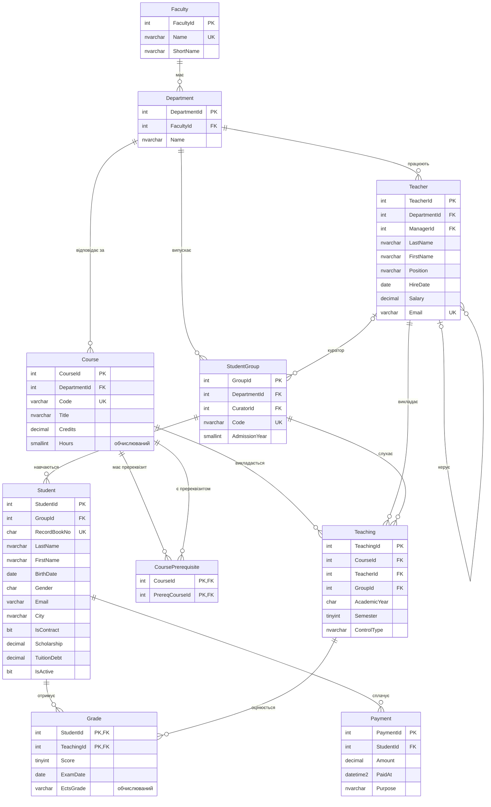

# Тестова база даних UniversityDB

`UniversityDB` моделює спрощений університет: факультети, кафедри, викладачів, групи,
студентів, дисципліни, розклад викладання, оцінки та оплату навчання.
Її використовують приклади в усіх темах курсу.

## Встановлення

Виконайте скрипти по черзі (у SSMS: **File → Open → File**, потім **Execute** або ++f5++):

| Скрипт | Що робить |
|--------|-----------|
| [01_create_database.sql](sql/01_create_database.sql) | створює базу, таблиці, обмеження, індекси та представлення |
| [02_seed_data.sql](sql/02_seed_data.sql) | заповнює таблиці тестовими даними |
| [03_knowledge_base.sql](sql/03_knowledge_base.sql) | створює схему `kb` для прикладів Теми 6 (бази знань) |

!!! warning "Увага"
    Скрипт 1 **видаляє** базу `UniversityDB`, якщо вона існує. Запускайте його щоразу,
    коли треба повернути базу до початкового стану.

Перевірка після встановлення:

```sql
USE UniversityDB;

SELECT 'Faculty' AS TableName, COUNT(*) AS Rows FROM dbo.Faculty
UNION ALL SELECT 'Department',   COUNT(*) FROM dbo.Department
UNION ALL SELECT 'Teacher',      COUNT(*) FROM dbo.Teacher
UNION ALL SELECT 'StudentGroup', COUNT(*) FROM dbo.StudentGroup
UNION ALL SELECT 'Student',      COUNT(*) FROM dbo.Student
UNION ALL SELECT 'Course',       COUNT(*) FROM dbo.Course
UNION ALL SELECT 'Teaching',     COUNT(*) FROM dbo.Teaching
UNION ALL SELECT 'Grade',        COUNT(*) FROM dbo.Grade
UNION ALL SELECT 'Payment',      COUNT(*) FROM dbo.Payment;
```

??? example "Результат"
    | TableName | Rows |
    |-----------|-----:|
    | Faculty | 2 |
    | Department | 4 |
    | Teacher | 11 |
    | StudentGroup | 5 |
    | Student | 17 |
    | Course | 9 |
    | Teaching | 12 |
    | Grade | 50 |
    | Payment | 8 |

## ER-діаграма



Окремо від діаграми є журнал `dbo.AuditLog` (його заповнюють тригери з Теми 7) та
представлення `dbo.vStudentGrades` (зведена відомість оцінок).

## Опис таблиць

| Таблиця | Зміст | Ключі та особливості |
|---------|-------|----------------------|
| `Faculty` | факультети | PK `FacultyId`, унікальна назва |
| `Department` | кафедри | FK → `Faculty`; назва унікальна в межах факультету |
| `Teacher` | викладачі | FK → `Department`; рекурсивний FK `ManagerId` → `Teacher` (ієрархія підпорядкування); `CHECK` на посаду та оклад |
| `StudentGroup` | академічні групи | FK → `Department`, необов'язковий FK `CuratorId` → `Teacher` |
| `Student` | студенти | сурогатний ключ `StudentId` і природний ключ `RecordBookNo` (номер залікової книжки); фільтрований унікальний індекс на `Email` |
| `Course` | дисципліни | обчислюваний стовпець `Hours = Credits × 30` |
| `CoursePrerequisite` | пререквізити | зв'язок M:N таблиці `Course` самої з собою |
| `Teaching` | хто, що і якій групі викладає | асоціативна сутність між `Course`, `Teacher` та `StudentGroup` |
| `Grade` | підсумкові оцінки | складений PK (`StudentId`, `TeachingId`); обчислюваний стовпець `EctsGrade` |
| `Payment` | оплати за навчання | `DEFAULT` для дати та призначення платежу |
| `AuditLog` | журнал змін | заповнюється тригерами |

### Особливості тестових даних

Дані підібрані так, щоб запити давали показові результати:

* студент **Литвиненко Богдан** (`StudentId = 5`) відрахований (`IsActive = 0`), тому має оцінки лише за 1-й семестр;
* у групи **ФН-24** немає ні студентів, ні куратора (знадобиться для `LEFT JOIN` і `NOT EXISTS`);
* дисципліна **«Розподілені системи»** ніде не викладається;
* завідувачі кафедр (`TeacherId` 1, 5, 8, 10) не ведуть занять;
* у частини студентів немає e-mail (`NULL`), а в контрактників є борг за навчання;
* 5 оцінок із 50 нижчі за 60 балів (незадовільні).

## Тексти скриптів

??? note "01_create_database.sql"
    ```sql
    --8<-- "sql/01_create_database.sql"
    ```

??? note "02_seed_data.sql"
    ```sql
    --8<-- "sql/02_seed_data.sql"
    ```

??? note "03_knowledge_base.sql"
    ```sql
    --8<-- "sql/03_knowledge_base.sql"
    ```
