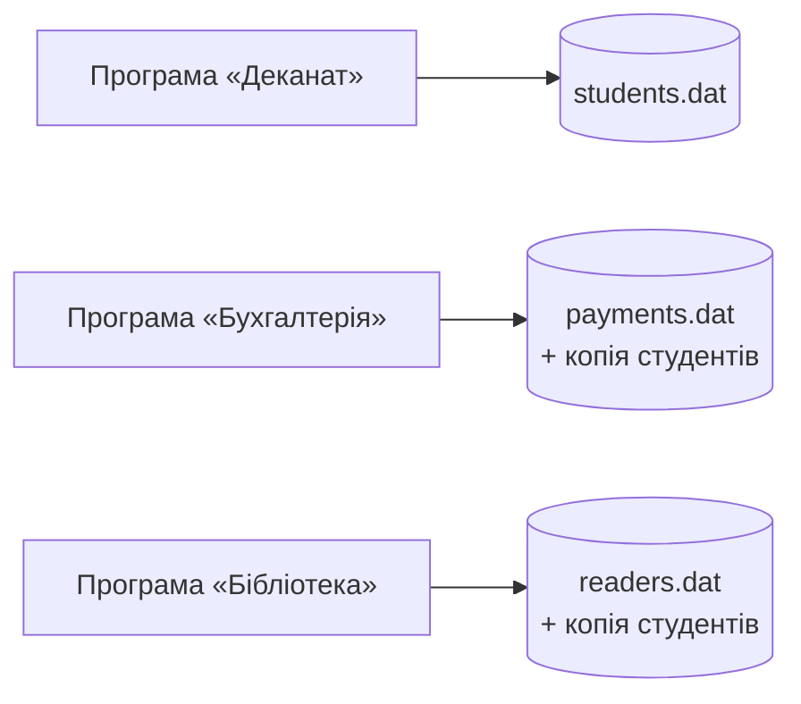
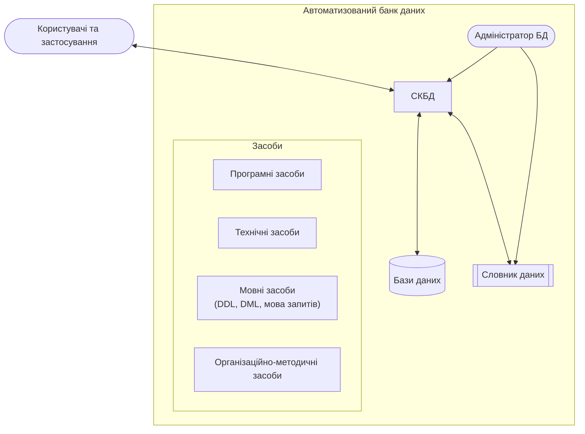
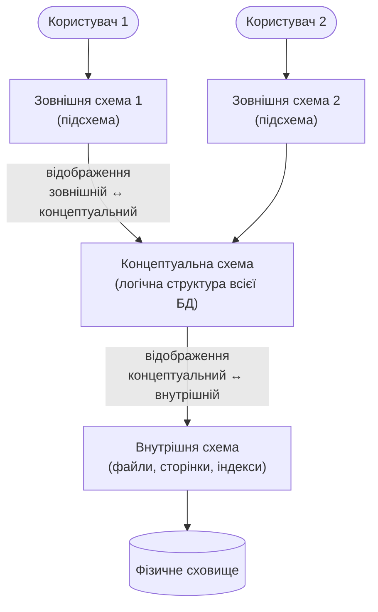

# Тема 1. Основні поняття про бази та банки даних

## 1.1. Інформаційні системи: визначення і класифікація

**Інформаційна система (ІС)** — це взаємопов'язана сукупність засобів, методів і персоналу,
що використовується для збирання, зберігання, обробки та видачі інформації в інтересах
досягнення поставленої мети.

**Автоматизована інформаційна система (АІС)** — ІС, у якій частину функцій виконують
комп'ютери та програмне забезпечення.

Класифікація ІС:

| Ознака | Види |
|--------|------|
| Ступінь автоматизації | ручні, автоматизовані, автоматичні |
| Характер обробки даних | **інформаційно-довідкові** (пошукові) — видають дані без обробки; **інформаційно-розв'язувальні** — обробляють дані за алгоритмами (керуючі, порадчі) |
| Сфера застосування | економічні, медичні, освітні, наукові, САПР, ГІС, організаційного управління |
| Масштаб | персональні (настільні), групові (робоча група), корпоративні |
| Архітектура | файл-серверні, клієнт-серверні, багатоланкові, хмарні |

Приклади: система «Електронний деканат» (організаційного управління), система
бронювання квитків, банківська система, ERP-система підприємства.

## 1.2. Призначення баз даних і баз знань

**База даних (БД)** — іменована сукупність структурованих даних, що відображає стан
об'єктів певної предметної області та їх відношень і використовується багатьма
застосуваннями.

**Система керування базами даних (СКБД)** — комплекс програмних і мовних засобів для
створення, ведення та спільного використання БД багатьма користувачами
(наприклад, Microsoft SQL Server, PostgreSQL, Oracle, MySQL).

**База знань (БЗ)** — сукупність формалізованих знань (фактів, правил, закономірностей)
про предметну область, з якої можна **виводити нові знання**. Якщо БД відповідає на
питання «що відомо?», то БЗ — ще й на «що з цього випливає?» (детальніше — у
[Темі 6](topic6.md)).

## 1.3. Інформаційні системи на автономних файлах

Історично першими були системи, де кожна прикладна програма мала **власні файли** даних:



Недоліки такого підходу:

* **надлишковість** — ті самі дані (ПІБ студента) зберігаються в кількох файлах;
* **суперечливість** — оновили прізвище в одному файлі, але не в іншому;
* **залежність програм від даних** — структура запису «зашита» в код, зміна формату
  файлу вимагає переписування всіх програм;
* **відсутність спільного доступу** та механізмів одночасної роботи;
* **слабкий захист** і відсутність засобів відновлення після збоїв.

## 1.4. Автоматизовані банки даних

**Автоматизований банк даних (АБнД)** — система спеціальним чином організованих баз
даних, програмних, технічних, мовних, організаційно-методичних засобів, призначених для
централізованого накопичення та колективного використання даних.

### Структура автоматизованого банку даних



* **Інформаційна компонента** — бази даних і словник даних.
* **Програмні засоби** — СКБД, утиліти, прикладні програми.
* **Технічні засоби** — сервери, сховища, мережа.
* **Мовні засоби** — мови опису та маніпулювання даними.
* **Організаційно-методичні засоби** — інструкції, регламенти, правила доступу.
* **Адміністратор БД** — фахівці, що відповідають за роботу банку даних.

### Схема взаємодії колективу спеціалістів

| Роль | Обов'язки |
|------|-----------|
| **Адміністратор даних** | аналізує предметну область, визначає, які дані зберігати, відповідає за концептуальну модель і політику безпеки |
| **Адміністратор БД (DBA)** | фізичне проектування, налаштування СКБД, резервне копіювання, продуктивність, видача прав |
| **Системні аналітики** | збирають вимоги користувачів, описують задачі |
| **Прикладні програмісти** | пишуть застосування, що працюють з БД через DML |
| **Кінцеві користувачі** | працюють з даними через застосування або мову запитів |

## 1.5. Архітектура СКБД. Принцип трирівневої організації даних

Комітет **ANSI/SPARC** запропонував трирівневу архітектуру, яка відокремлює те, як
користувачі бачать дані, від того, як вони фізично зберігаються:



| Рівень | Що описує | У SQL Server |
|--------|-----------|--------------|
| **Зовнішній** | дані, потрібні конкретному користувачу (підсхема) | представлення (`VIEW`), права доступу, схеми (`SCHEMA`) |
| **Концептуальний** | усі сутності, атрибути, зв'язки та обмеження | таблиці, ключі, `CHECK`, `FOREIGN KEY` |
| **Внутрішній** | способи зберігання та доступу | файли `.mdf/.ldf`, сторінки по 8 КБ, індекси |

Головна мета — **незалежність даних**:

* **логічна незалежність** — зміна концептуальної схеми (наприклад, додавання стовпця)
  не потребує зміни зовнішніх схем і програм;
* **фізична незалежність** — зміна способу зберігання (новий індекс, інший диск) не
  впливає на концептуальну схему.

### Приклад: три рівні в UniversityDB

**Концептуальний рівень** — опис таблиці мовою DDL (фрагмент зі скрипту створення):

```sql
USE UniversityDB;

-- Як таблиця Student виглядає на концептуальному рівні
SELECT COLUMN_NAME, DATA_TYPE, CHARACTER_MAXIMUM_LENGTH, IS_NULLABLE
FROM INFORMATION_SCHEMA.COLUMNS
WHERE TABLE_SCHEMA = 'dbo' AND TABLE_NAME = 'Student'
ORDER BY ORDINAL_POSITION;
```

**Зовнішній рівень** — підсхема для працівника бухгалтерії: йому потрібні лише ПІБ,
група та фінансові дані, а не дата народження чи e-mail.

```sql
CREATE SCHEMA accounting;
GO

CREATE VIEW accounting.vStudentFinance
AS
SELECT s.StudentId,
       s.LastName + N' ' + s.FirstName AS FullName,
       g.Code AS GroupCode,
       s.IsContract,
       s.Scholarship,
       s.TuitionDebt
FROM dbo.Student AS s
JOIN dbo.StudentGroup AS g ON g.GroupId = s.GroupId
WHERE s.IsActive = 1;
GO

-- Роль бухгалтера бачить ЛИШЕ свою підсхему
CREATE ROLE AccountantRole;
GRANT SELECT ON SCHEMA::accounting TO AccountantRole;

SELECT * FROM accounting.vStudentFinance WHERE TuitionDebt > 0;
```

??? example "Результат"
    | StudentId | FullName | GroupCode | IsContract | Scholarship | TuitionDebt |
    |---:|---|---|---:|---:|---:|
    | 3 | Сидоренко Максим | ПІ-21 | 1 | 0.00 | 18000.00 |
    | 7 | Павленко Денис | ПІ-22 | 1 | 0.00 | 9000.00 |
    | 9 | Романенко Артем | ПІ-22 | 1 | 0.00 | 18000.00 |
    | 13 | Демченко Віталій | КН-21 | 1 | 0.00 | 4500.00 |
    | 15 | Василенко Роман | ЕК-22 | 1 | 0.00 | 15000.00 |

**Внутрішній рівень** — файли бази та індекси таблиці:

```sql
-- Фізичні файли бази даних
SELECT name, type_desc, physical_name, size * 8 / 1024 AS SizeMB
FROM sys.database_files;

-- Індекси (структури доступу) таблиці Student
SELECT i.name, i.type_desc, i.is_unique, i.has_filter
FROM sys.indexes AS i
WHERE i.object_id = OBJECT_ID(N'dbo.Student');
```

**Логічна незалежність на практиці**: додамо стовпець у таблицю — представлення
бухгалтерії та програми, що його використовують, продовжать працювати без змін.

```sql
ALTER TABLE dbo.Student ADD Phone VARCHAR(20) NULL;

SELECT TOP (3) * FROM accounting.vStudentFinance;   -- працює як і раніше

ALTER TABLE dbo.Student DROP COLUMN Phone;           -- повертаємо як було
```

## 1.6. Мовні засоби: мова опису даних і мова маніпулювання даними

| Мова | Призначення | Оператори SQL |
|------|-------------|---------------|
| **Мова опису даних** (DDL, Data Definition Language) | опис схеми: таблиці, обмеження, представлення | `CREATE`, `ALTER`, `DROP` |
| **Мова опису підсхем** | опис зовнішнього рівня — частини БД, доступної користувачу | `CREATE VIEW`, `CREATE SCHEMA` |
| **Мова маніпулювання даними** (DML, Data Manipulation Language) | вибірка та зміна даних | `SELECT`, `INSERT`, `UPDATE`, `DELETE`, `MERGE` |
| **Мова керування даними** (DCL, Data Control Language) | права доступу | `GRANT`, `REVOKE`, `DENY` |

У сучасних СКБД усі ці мови об'єднані в **SQL**:

```sql
-- DDL: опис даних
CREATE TABLE dbo.Room (
    RoomId   INT IDENTITY PRIMARY KEY,
    Building NVARCHAR(10) NOT NULL,
    Number   NVARCHAR(10) NOT NULL,
    Seats    SMALLINT NOT NULL CHECK (Seats > 0)
);

-- DML: маніпулювання даними
INSERT INTO dbo.Room (Building, Number, Seats)
VALUES (N'1', N'101', 30), (N'1', N'205', 120), (N'2', N'14', 24);

UPDATE dbo.Room SET Seats = 32 WHERE Number = N'101';

SELECT * FROM dbo.Room WHERE Seats >= 30;

DELETE FROM dbo.Room WHERE Building = N'2';

-- DCL: керування доступом
GRANT SELECT ON dbo.Room TO AccountantRole;

-- DDL: видалення
DROP TABLE dbo.Room;
```

## 1.7. Словник даних

**Словник даних** (каталог, метадані) — це «база даних про базу даних»: він містить опис
усіх об'єктів (таблиць, стовпців, типів, ключів, користувачів, прав), їх зв'язків та
використання. Словник потрібен і СКБД (щоб виконувати запити), і адміністратору (щоб
розуміти структуру).

У SQL Server словник доступний через **представлення каталогу** `sys.*` та стандартні
представлення **`INFORMATION_SCHEMA`**:

```sql
-- Усі таблиці бази та кількість рядків у них
SELECT s.name AS SchemaName, t.name AS TableName, SUM(p.rows) AS RowCount_
FROM sys.tables AS t
JOIN sys.schemas AS s ON s.schema_id = t.schema_id
JOIN sys.partitions AS p ON p.object_id = t.object_id AND p.index_id IN (0, 1)
WHERE s.name = 'dbo'
GROUP BY s.name, t.name
ORDER BY t.name;

-- Усі зовнішні ключі: хто на кого посилається
SELECT fk.name                              AS ForeignKey,
       OBJECT_NAME(fk.parent_object_id)     AS ChildTable,
       OBJECT_NAME(fk.referenced_object_id) AS ParentTable
FROM sys.foreign_keys AS fk
ORDER BY ChildTable;

-- Усі обмеження CHECK з їх умовами
SELECT OBJECT_NAME(parent_object_id) AS TableName, name, definition
FROM sys.check_constraints;
```

Словник можна доповнювати власними описами через **розширені властивості**:

```sql
EXEC sys.sp_addextendedproperty
     @name = N'MS_Description', @value = N'Номер залікової книжки студента',
     @level0type = N'SCHEMA', @level0name = N'dbo',
     @level1type = N'TABLE',  @level1name = N'Student',
     @level2type = N'COLUMN', @level2name = N'RecordBookNo';

SELECT objname, value
FROM sys.fn_listextendedproperty(N'MS_Description', N'SCHEMA', N'dbo',
                                 N'TABLE', N'Student', N'COLUMN', DEFAULT);
```

## 1.8. Вимоги до банків даних

* **Адекватність** відображення предметної області.
* **Цілісність** (integrity) — дані коректні та узгоджені (у SQL Server забезпечується
  `PRIMARY KEY`, `FOREIGN KEY`, `CHECK`, `UNIQUE`, `NOT NULL`, тригерами).
* **Мінімальна надлишковість** — кожен факт зберігається один раз.
* **Незалежність даних** від програм (логічна та фізична).
* **Безпека** — захист від несанкціонованого доступу (`GRANT`/`DENY`, ролі, шифрування).
* **Відновлюваність** після збоїв (журнал транзакцій, резервні копії).
* **Паралельний доступ** багатьох користувачів (транзакції, блокування).
* **Продуктивність** — прийнятний час відгуку.
* **Розширюваність** — можливість змінювати структуру без перебудови всієї системи.

Приклад: СКБД сама не дасть порушити цілісність.

```sql
-- Помилка: група з GroupId = 99 не існує (порушення FOREIGN KEY)
INSERT INTO dbo.Student (GroupId, RecordBookNo, LastName, FirstName, BirthDate, Gender)
VALUES (99, '99999999', N'Тест', N'Тест', '2005-01-01', 'M');

-- Помилка: оцінка має бути від 0 до 100 (порушення CHECK)
UPDATE dbo.Grade SET Score = 150 WHERE StudentId = 1 AND TeachingId = 1;
```

## 1.9. Принципи побудови банків даних

1. **Інтеграція даних** — єдине сховище для всіх застосувань замість окремих файлів.
2. **Централізоване керування** даними (адміністратор БД, єдиний словник).
3. **Незалежність даних** від прикладних програм (трирівнева архітектура).
4. **Мінімізація надлишковості** (нормалізація, [Тема 4](topic4.md)).
5. **Підтримка цілісності** та безпеки на рівні СКБД, а не програм.
6. **Розвиток** — можливість поступово нарощувати структуру.

## Контрольні питання

1. Чим база даних відрізняється від бази знань?
2. Які недоліки мають інформаційні системи на автономних файлах?
3. З яких компонентів складається автоматизований банк даних?
4. Опишіть три рівні архітектури ANSI/SPARC і наведіть приклад кожного в SQL Server.
5. Що таке логічна та фізична незалежність даних?
6. Яку інформацію містить словник даних? Як отримати список усіх зовнішніх ключів БД?
7. Чим відрізняються обов'язки адміністратора даних і адміністратора БД?
