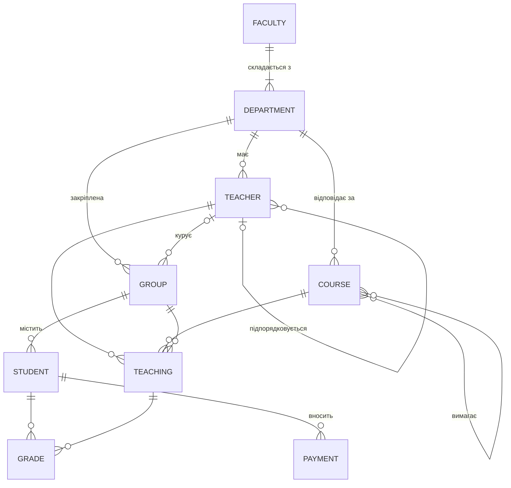

# Тема 2. Інфологічна модель даних

## 2.1. Основні поняття

**Предметна область (ПО)** — частина реального світу, дані про яку зберігаються в БД
(у нашому прикладі — навчальний процес університету).

**Інфологічна модель** — опис предметної області, не прив'язаний до конкретної СКБД,
зрозумілий і замовнику, і розробнику. Найпоширеніший спосіб її побудови — модель
**«сутність — зв'язок»** (ER-модель, Entity–Relationship, П. Чен, 1976).

| Поняття | Визначення | Приклад |
|---------|-----------|---------|
| **Сутність** (entity) | клас реальних чи абстрактних об'єктів, про які зберігається інформація | Студент, Група, Дисципліна |
| **Екземпляр сутності** | конкретний об'єкт класу | студент Петренко Іван |
| **Атрибут** | властивість сутності | Прізвище, Дата народження |
| **Ключ** | атрибут (набір), що однозначно ідентифікує екземпляр | Номер залікової книжки |
| **Зв'язок** (relationship) | асоціація між сутностями | Студент *навчається в* Групі |

## 2.2. Рівні моделей даних


| Рівень | Залежить від | Результат для UniversityDB |
|--------|-------------|----------------------------|
| Інфологічний | лише від предметної області | ER-діаграма: сутності Студент, Група, … |
| Даталогічний | від типу моделі даних (реляційна) | відношення `Student(StudentId, GroupId, …)` |
| Фізичний | від конкретної СКБД | `CREATE TABLE dbo.Student (... NVARCHAR(50) ...)`, індекси |

## 2.3. Характеристика зв'язків

Зв'язок характеризується двома властивостями:

**Кардинальність** (потужність) — скільки екземплярів однієї сутності може бути пов'язано
з одним екземпляром іншої:

| Тип | Позначення | Приклад |
|-----|-----------|---------|
| Один до одного | 1 : 1 | Група — Староста групи |
| Один до багатьох | 1 : N | Група — Студенти |
| Багато до багатьох | M : N | Студенти — Дисципліни |

**Обов'язковість** (клас належності) — чи кожен екземпляр сутності **мусить** брати участь
у зв'язку:

* *обов'язкова* — кожен студент обов'язково належить до групи;
* *необов'язкова* — група може не мати куратора (група ФН-24).

### Типи асоціацій

Асоціація — це «напрямлений» зв'язок від однієї сутності до іншої. Розрізняють чотири типи:

| Тип | Позначення | Скільки екземплярів B відповідає одному A | Приклад (A → B) |
|-----|:---------:|-------------------------------------------|-----------------|
| Проста | **1** | рівно один | Студент → Група |
| Умовна | **C** | нуль або один | Група → Куратор |
| Множинна | **M** | один або більше | Група (сформована) → Студенти |
| Умовно-множинна | **MC** | нуль, один або більше | Викладач → Дисципліни, які він веде |

Зв'язок описують парою асоціацій. Наприклад, «Група — Студент» = **1 : MC**
(у студента рівно одна група; у групи — нуль або більше студентів).

## 2.4. Класифікація сутностей

| Вид сутності | Опис | Приклад в UniversityDB |
|--------------|------|------------------------|
| **Стрижнева** (сильна) | існує самостійно, не залежить від інших | Факультет, Студент, Дисципліна |
| **Асоціативна** | реалізує зв'язок M:N між сутностями, може мати власні атрибути | Викладання (`Teaching`), Оцінка (`Grade`) |
| **Характеристична** (слабка) | описує іншу сутність і не існує без неї | Оплата (`Payment`) — не існує без студента |
| **Позначальна** | позначає (посилається на) іншу сутність, зв'язок 1:N | Група позначає кафедру (`DepartmentId`) |
| **Підтип / супертип** | ієрархія узагальнення: спільні атрибути в супертипі | Людина → Студент, Викладач |

## 2.5. Аналіз предметної області

Опис ПО «Університет» (вимоги замовника):

> Університет складається з факультетів, факультети — з кафедр. На кафедрах працюють
> викладачі, які мають посаду, оклад і безпосереднього керівника. Студенти навчаються в
> академічних групах; кожна група закріплена за кафедрою і може мати куратора з числа
> викладачів. Кафедри відповідають за дисципліни; дисципліна має кількість кредитів ЄКТС
> і може вимагати попереднього вивчення інших дисциплін. Викладач читає дисципліну
> певній групі в певному семестрі. Студент отримує з дисципліни оцінку за 100-бальною
> шкалою. Студенти-контрактники вносять оплату за навчання.

Аналіз тексту: **іменники** → кандидати в сутності та атрибути, **дієслова** → зв'язки.

| Сутність | Атрибути | Зв'язки |
|----------|----------|---------|
| Факультет | назва, абревіатура | *складається з* кафедр |
| Кафедра | назва | *має* викладачів, групи, дисципліни |
| Викладач | ПІБ, посада, оклад, дата прийняття, e-mail | *підпорядковується* викладачу; *курує* групу; *читає* дисципліну |
| Група | шифр, рік вступу | *містить* студентів |
| Студент | № залікової, ПІБ, дата народження, стать, e-mail, місто, форма фінансування | *навчається в* групі; *отримує* оцінки; *вносить* оплату |
| Дисципліна | код, назва, кредити | *вимагає* інших дисциплін |

## 2.6. Розробка універсального відношення

**Універсальне відношення** — одна таблиця, що містить **усі атрибути** предметної області.
Це відправна точка для нормалізації ([Тема 4](topic4.md)). Його легко отримати
з нашої БД, з'єднавши всі таблиці:

```sql
USE UniversityDB;

SELECT  f.Name         AS Faculty,
        d.Name         AS Department,
        g.Code         AS GroupCode,
        s.RecordBookNo,
        s.LastName + N' ' + s.FirstName AS Student,
        c.Code         AS CourseCode,
        c.Title        AS Course,
        c.Credits,
        tc.LastName    AS Teacher,
        tc.Position,
        t.Semester,
        gr.Score
INTO #UniversalRelation
FROM dbo.Grade        AS gr
JOIN dbo.Student      AS s  ON s.StudentId     = gr.StudentId
JOIN dbo.StudentGroup AS g  ON g.GroupId       = s.GroupId
JOIN dbo.Department   AS d  ON d.DepartmentId  = g.DepartmentId
JOIN dbo.Faculty      AS f  ON f.FacultyId     = d.FacultyId
JOIN dbo.Teaching     AS t  ON t.TeachingId    = gr.TeachingId
JOIN dbo.Course       AS c  ON c.CourseId      = t.CourseId
JOIN dbo.Teacher      AS tc ON tc.TeacherId    = t.TeacherId;

SELECT TOP (6) * FROM #UniversalRelation ORDER BY RecordBookNo, CourseCode;
```

??? example "Результат"
    | Faculty | Department | GroupCode | RecordBookNo | Student | CourseCode | Course | Credits | Teacher | Position | Semester | Score |
    |---|---|---|---|---|---|---|---:|---|---|---:|---:|
    | Факультет інформаційних технологій | Кафедра програмної інженерії | ПІ-21 | 21010001 | Петренко Іван | DB101 | Бази даних | 6.0 | Шевченко | професор | 2 | 67 |
    | Факультет інформаційних технологій | Кафедра програмної інженерії | ПІ-21 | 21010001 | Петренко Іван | MATH101 | Вища математика | 6.0 | Мороз | доцент | 1 | 55 |
    | Факультет інформаційних технологій | Кафедра програмної інженерії | ПІ-21 | 21010001 | Петренко Іван | PRG101 | Основи програмування | 5.0 | Бондар | доцент | 1 | 84 |
    | Факультет інформаційних технологій | Кафедра програмної інженерії | ПІ-21 | 21010001 | Петренко Іван | PRG201 | Об'єктно-орієнтоване програмування | 5.0 | Ткаченко | асистент | 2 | 96 |
    | Факультет інформаційних технологій | Кафедра програмної інженерії | ПІ-21 | 21010002 | Іваненко Олена | DB101 | Бази даних | 6.0 | Шевченко | професор | 2 | 84 |
    | … | | | | | | | | | | | |

Проблеми універсального відношення добре видно на цих даних (виконуйте в тому самому
вікні запитів, бо `#UniversalRelation` — тимчасова таблиця сеансу):

```sql
-- Надлишковість: назва факультету повторюється в кожному рядку
SELECT Faculty, COUNT(*) AS Repeats
FROM #UniversalRelation
GROUP BY Faculty;

-- Аномалія оновлення: щоб перейменувати дисципліну, треба змінити багато рядків
-- (а пропуск хоча б одного дасть суперечливі дані)
SELECT COUNT(*) AS RowsToUpdate FROM #UniversalRelation WHERE CourseCode = 'DB101';

-- Аномалія вставки: нову дисципліну «Розподілені системи» неможливо додати,
-- доки її ніхто не вивчає й не отримав оцінку.
-- Аномалія видалення: видаливши оцінки групи, втратимо інформацію про її куратора.
```

Усунення цих аномалій — мета **нормалізації**, яка розбиває універсальне відношення на
таблиці, що ми бачимо на ER-діаграмі.

## 2.7. Розробка ER-моделі предметної області

Етапи побудови ER-моделі:

1. Виділити **сутності** та їх **ключі**.
2. Визначити **атрибути** кожної сутності.
3. Визначити **зв'язки**, їх кардинальність та обов'язковість.
4. Замінити зв'язки M:N **асоціативними сутностями**.
5. Виділити **підтипи** (за потреби) та перевірити модель із замовником.

ER-діаграма ПО «Університет» (нотація «воронячої лапки»: `||` — рівно один,
`o|` — нуль або один, `o{` — нуль або більше, `|{` — один або більше):



Повна ER-діаграма з атрибутами — на сторінці [Тестова база даних](../database.md#er-діаграма).

### Як зв'язки ER-моделі реалізуються в SQL Server

=== "1 : N"

    Зовнішній ключ на боці «багато»:

    ```sql
    -- Кожен студент належить рівно одній групі (обов'язковий зв'язок: NOT NULL)
    SELECT name, is_nullable
    FROM sys.columns
    WHERE object_id = OBJECT_ID(N'dbo.Student') AND name = 'GroupId';
    ```

=== "1 : 1"

    Зовнішній ключ + обмеження `UNIQUE` (один староста на групу, і студент — староста
    не більше ніж однієї групи):

    ```sql
    CREATE TABLE dbo.GroupLeader (
        GroupId   INT NOT NULL PRIMARY KEY REFERENCES dbo.StudentGroup(GroupId),
        StudentId INT NOT NULL UNIQUE      REFERENCES dbo.Student(StudentId)
    );

    INSERT INTO dbo.GroupLeader (GroupId, StudentId) VALUES (1, 2), (3, 10);

    -- Помилка: студент 2 вже староста (порушення UNIQUE)
    INSERT INTO dbo.GroupLeader (GroupId, StudentId) VALUES (2, 2);

    DROP TABLE dbo.GroupLeader;
    ```

=== "M : N"

    Окрема асоціативна таблиця з двома зовнішніми ключами:

    ```sql
    -- Дисципліна «Штучний інтелект» вимагає двох дисциплін,
    -- а «Вища математика» є пререквізитом для двох дисциплін
    SELECT c.Title AS Course, p.Title AS Requires
    FROM dbo.CoursePrerequisite AS cp
    JOIN dbo.Course AS c ON c.CourseId = cp.CourseId
    JOIN dbo.Course AS p ON p.CourseId = cp.PrereqCourseId
    ORDER BY c.Title;
    ```

=== "Підтипи"

    Супертип `Person` зі спільними атрибутами і підтипи з власними:

    ```sql
    CREATE TABLE dbo.Person (
        PersonId   INT IDENTITY PRIMARY KEY,
        FullName   NVARCHAR(100) NOT NULL,
        PersonType CHAR(1) NOT NULL CHECK (PersonType IN ('S', 'T')),  -- дискримінатор
        CONSTRAINT UQ_Person_Type UNIQUE (PersonId, PersonType)
    );

    CREATE TABLE dbo.PersonStudent (
        PersonId   INT PRIMARY KEY,
        PersonType AS CAST('S' AS CHAR(1)) PERSISTED,
        GroupCode  NVARCHAR(10) NOT NULL,
        FOREIGN KEY (PersonId, PersonType) REFERENCES dbo.Person(PersonId, PersonType)
    );

    CREATE TABLE dbo.PersonTeacher (
        PersonId   INT PRIMARY KEY,
        PersonType AS CAST('T' AS CHAR(1)) PERSISTED,
        Position   NVARCHAR(30) NOT NULL,
        FOREIGN KEY (PersonId, PersonType) REFERENCES dbo.Person(PersonId, PersonType)
    );

    INSERT INTO dbo.Person (FullName, PersonType) VALUES (N'Петренко Іван', 'S'), (N'Шевченко Ірина', 'T');
    INSERT INTO dbo.PersonStudent (PersonId, GroupCode) VALUES (1, N'ПІ-21');
    INSERT INTO dbo.PersonTeacher (PersonId, Position)  VALUES (2, N'професор');

    -- Помилка: особа 1 — студент, тому не може бути викладачем
    INSERT INTO dbo.PersonTeacher (PersonId, Position) VALUES (1, N'доцент');

    DROP TABLE dbo.PersonStudent, dbo.PersonTeacher, dbo.Person;
    ```

### Перевірка кардинальності на даних

ER-модель каже, що в групи може бути **нуль** студентів і **нуль** кураторів (MC та C).
Перевіримо, що таке справді трапляється:

```sql
SELECT g.Code,
       COUNT(s.StudentId)                         AS Students,
       ISNULL(t.LastName, N'— немає куратора —')  AS Curator
FROM dbo.StudentGroup AS g
LEFT JOIN dbo.Student AS s ON s.GroupId  = g.GroupId
LEFT JOIN dbo.Teacher AS t ON t.TeacherId = g.CuratorId
GROUP BY g.Code, t.LastName
ORDER BY g.Code;
```

??? example "Результат"
    | Code | Students | Curator |
    |------|---------:|---------|
    | ЕК-22 | 4 | Мороз |
    | КН-21 | 4 | Кравченко |
    | ПІ-21 | 5 | Бондар |
    | ПІ-22 | 4 | Ткаченко |
    | ФН-24 | 0 | — немає куратора — |

## Контрольні питання

1. Назвіть рівні моделей даних і поясніть, від чого залежить кожен із них.
2. Чим кардинальність зв'язку відрізняється від його обов'язковості?
3. Наведіть приклади чотирьох типів асоціацій (1, C, M, MC) у ПО «Університет».
4. Чим асоціативна сутність відрізняється від характеристичної?
5. Що таке універсальне відношення? Які аномалії воно має?
6. Як реалізувати зв'язки 1:1 і M:N у реляційній БД?
7. Побудуйте ER-модель для ПО «Бібліотека» (книги, автори, читачі, видачі).
