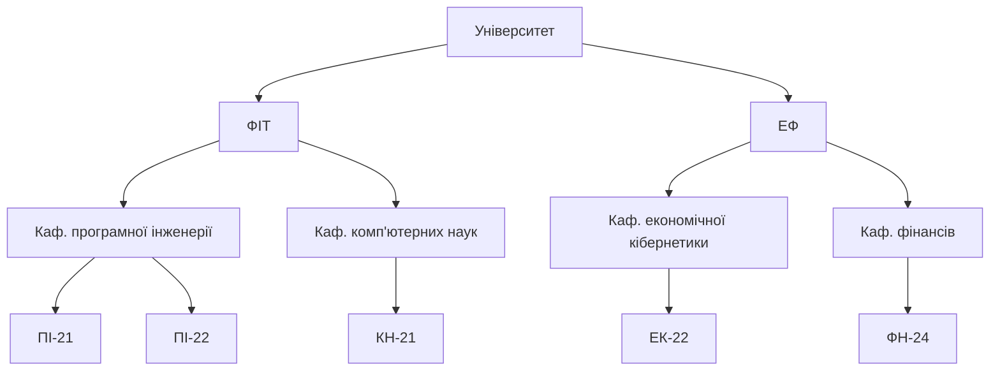
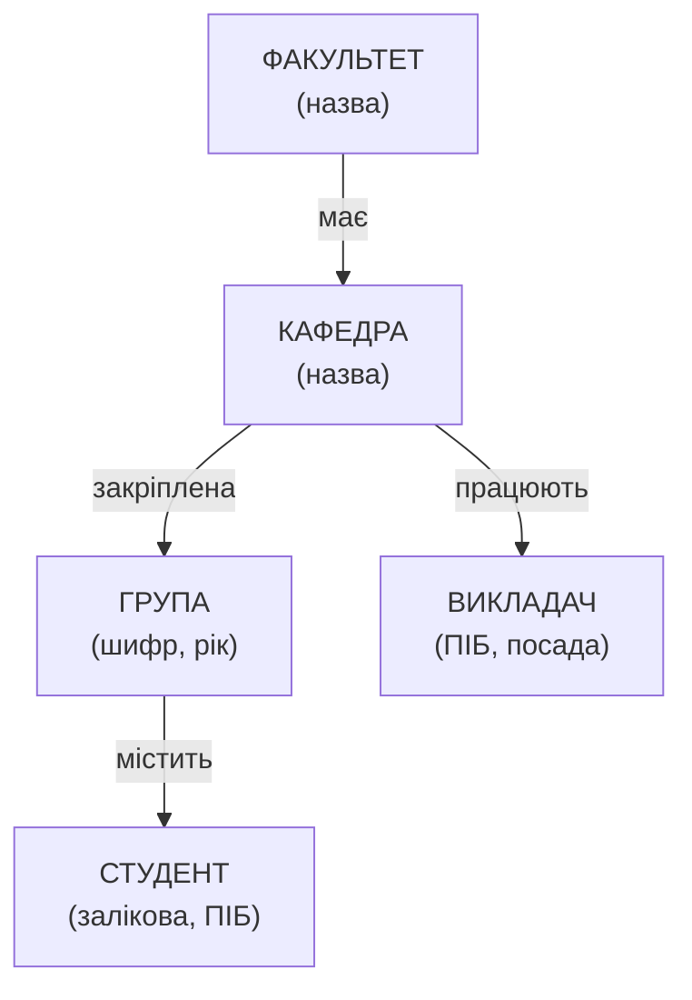
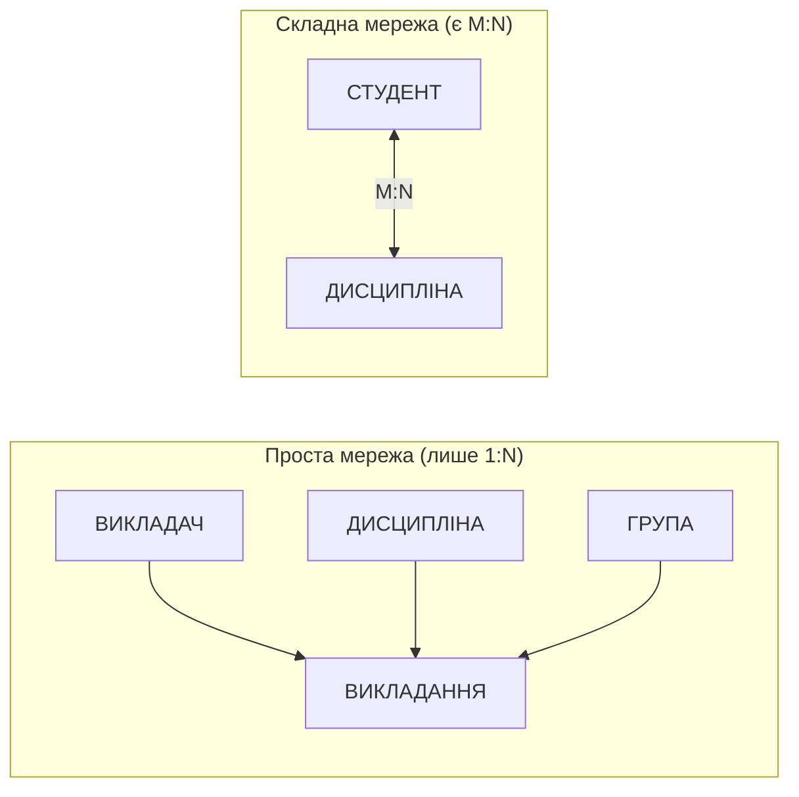

# Тема 3. Моделі даних

**Модель даних** — сукупність правил структурування даних, допустимих операцій над ними
та обмежень цілісності. Класичні (даталогічні) моделі:

| Модель | Структура | Зв'язки | Приклади СКБД |
|--------|-----------|---------|---------------|
| **Ієрархічна** | дерево записів | лише 1:N, у кожного запису один предок | IBM IMS, реєстр Windows, XML/JSON |
| **Мережна** | довільний граф записів | 1:N через набори (sets), M:N через записи-зв'язки | IDMS (CODASYL), графові БД |
| **Реляційна** | таблиці (відношення) | через значення ключів | SQL Server, PostgreSQL, Oracle |

## 3.1. Ієрархічна модель даних

Ієрархічна БД — це сукупність **дерев**. Кожне дерево складається з **кореня** та
підпорядкованих вузлів; кожен вузол (крім кореня) має **рівно одного предка** і може
мати будь-яку кількість **нащадків**. Вузли одного предка називаються **близнюками**.



### Збалансоване дерево

Дерево називається **збалансованим**, якщо всі шляхи від кореня до листків мають однакову
довжину (або різняться не більше ніж на 1). У збалансованому дереві час пошуку будь-якого
вузла однаковий і пропорційний висоті дерева, тобто `O(log n)`.

Саме на **B-деревах** (balanced trees) побудовані індекси SQL Server. Висоту дерева
індексу можна побачити так:

```sql
USE UniversityDB;

SELECT OBJECT_NAME(ips.object_id) AS TableName,
       i.name                     AS IndexName,
       ips.index_depth            AS TreeHeight,   -- кількість рівнів B-дерева
       ips.page_count
FROM sys.dm_db_index_physical_stats(DB_ID(), OBJECT_ID(N'dbo.Grade'), NULL, NULL, 'DETAILED') AS ips
JOIN sys.indexes AS i ON i.object_id = ips.object_id AND i.index_id = ips.index_id
WHERE ips.index_level = 0;
```

У тестовій БД таблиці маленькі, тому дерево має лише 1 рівень. У таблиці з мільйонами
рядків висота B-дерева зазвичай становить 3–4 рівні: щоб знайти будь-який рядок,
достатньо прочитати 3–4 сторінки.

### Діаграма Бахмана

**Діаграма Бахмана** (діаграма структури даних, Ч. Бахман, 1969) — графічне подання
схеми ієрархічної чи мережної БД: **прямокутники** — типи записів, **стрілки** — зв'язки
типу «власник → член» (1:N), стрілка спрямована від власника до члена.



### Ієрархія в SQL Server: тип `hierarchyid`

SQL Server має спеціальний тип `hierarchyid`, що зберігає позицію вузла в дереві
(наприклад, `/1/2/` — другий нащадок першого нащадка кореня).

```sql
CREATE TABLE dbo.OrgUnit (
    Node     HIERARCHYID PRIMARY KEY,
    Level    AS Node.GetLevel(),          -- рівень вузла (корінь = 0)
    UnitName NVARCHAR(100) NOT NULL,
    UnitType NVARCHAR(20)  NOT NULL
);

INSERT INTO dbo.OrgUnit (Node, UnitName, UnitType) VALUES
 ('/',        N'Університет',                    N'університет'),
 ('/1/',      N'ФІТ',                            N'факультет'),
 ('/2/',      N'ЕФ',                             N'факультет'),
 ('/1/1/',    N'Каф. програмної інженерії',      N'кафедра'),
 ('/1/2/',    N'Каф. комп''ютерних наук',        N'кафедра'),
 ('/2/1/',    N'Каф. економічної кібернетики',   N'кафедра'),
 ('/2/2/',    N'Каф. фінансів',                  N'кафедра'),
 ('/1/1/1/',  N'ПІ-21', N'група'),
 ('/1/1/2/',  N'ПІ-22', N'група'),
 ('/1/2/1/',  N'КН-21', N'група'),
 ('/2/1/1/',  N'ЕК-22', N'група'),
 ('/2/2/1/',  N'ФН-24', N'група');

-- Обхід дерева в глибину (порядок сортування hierarchyid = прямий обхід)
SELECT REPLICATE(N'    ', Level) + UnitName AS Tree, Node.ToString() AS Path, Level
FROM dbo.OrgUnit
ORDER BY Node;
```

??? example "Результат"
    ```text
    Tree                                   Path      Level
    Університет                            /         0
        ФІТ                                /1/       1
            Каф. програмної інженерії      /1/1/     2
                ПІ-21                      /1/1/1/   3
                ПІ-22                      /1/1/2/   3
            Каф. комп'ютерних наук         /1/2/     2
                КН-21                      /1/2/1/   3
        ЕФ                                 /2/       1
            Каф. економічної кібернетики   /2/1/     2
                ЕК-22                      /2/1/1/   3
            Каф. фінансів                  /2/2/     2
                ФН-24                      /2/2/1/   3
    ```

### Типові оператори маніпулювання ієрархічними даними

У СКБД IMS мова DL/I має оператори навігації деревом. Ось їхні аналоги на `hierarchyid`:

| Оператор DL/I | Призначення | Аналог у SQL Server |
|---------------|-------------|---------------------|
| `GET UNIQUE` (GU) | знайти конкретний вузол | `WHERE UnitName = ...` |
| `GET NEXT` (GN) | наступний вузол у порядку обходу | `WHERE Node > @cur ORDER BY Node` |
| `GET NEXT WITHIN PARENT` (GNP) | наступний нащадок того самого предка | `WHERE Node.GetAncestor(1) = @parent` |
| `INSERT` (ISRT) | вставити вузол | `@parent.GetDescendant(@last, NULL)` |
| `DELETE` (DLET) | видалити вузол **разом з усім піддеревом** | `WHERE Node.IsDescendantOf(@n) = 1` |
| `REPLACE` (REPL) | змінити дані вузла | `UPDATE` |

```sql
DECLARE @fit HIERARCHYID = (SELECT Node FROM dbo.OrgUnit WHERE UnitName = N'ФІТ');  -- GU

-- GNP: усі безпосередні нащадки ФІТ
SELECT UnitName FROM dbo.OrgUnit WHERE Node.GetAncestor(1) = @fit;

-- Усе піддерево ФІТ
SELECT UnitName, Level FROM dbo.OrgUnit WHERE Node.IsDescendantOf(@fit) = 1 ORDER BY Node;

-- ISRT: додати нову групу ПІ-23 після останньої групи кафедри програмної інженерії
DECLARE @dep  HIERARCHYID = (SELECT Node FROM dbo.OrgUnit WHERE UnitName = N'Каф. програмної інженерії');
DECLARE @last HIERARCHYID = (SELECT MAX(Node) FROM dbo.OrgUnit WHERE Node.GetAncestor(1) = @dep);
INSERT INTO dbo.OrgUnit (Node, UnitName, UnitType)
VALUES (@dep.GetDescendant(@last, NULL), N'ПІ-23', N'група');

-- Шлях від вузла до кореня (усі предки групи ПІ-23)
DECLARE @g HIERARCHYID = (SELECT Node FROM dbo.OrgUnit WHERE UnitName = N'ПІ-23');
SELECT UnitName, Level FROM dbo.OrgUnit WHERE @g.IsDescendantOf(Node) = 1 ORDER BY Level;

-- DLET: видалення кафедри видаляє і всі її групи
DELETE FROM dbo.OrgUnit WHERE Node.IsDescendantOf(@dep) = 1;
SELECT COUNT(*) AS UnitsLeft FROM dbo.OrgUnit;   -- 9 замість 13
```

Інший спосіб зберігати дерево в реляційній таблиці — **список суміжності**
(посилання на предка). Так зберігається підпорядкування викладачів (`Teacher.ManagerId`),
а обходять таке дерево **рекурсивним CTE**:

```sql
WITH Hierarchy AS (
    SELECT TeacherId, LastName, Position, 0 AS Lvl,
           CAST(LastName AS NVARCHAR(400)) AS PathStr
    FROM dbo.Teacher
    WHERE ManagerId IS NULL                       -- корені: завідувачі кафедр
    UNION ALL
    SELECT t.TeacherId, t.LastName, t.Position, h.Lvl + 1,
           CAST(h.PathStr + N' → ' + t.LastName AS NVARCHAR(400))
    FROM dbo.Teacher AS t
    JOIN Hierarchy   AS h ON t.ManagerId = h.TeacherId
)
SELECT REPLICATE(N'    ', Lvl) + LastName AS Tree, Position, PathStr
FROM Hierarchy
ORDER BY PathStr;
```

### Переваги та недоліки ієрархічних структур

| Переваги | Недоліки |
|----------|----------|
| проста, наочна структура | не можна прямо подати зв'язок M:N |
| швидкий доступ «зверху вниз» | доступ до вузла — лише через корінь |
| ефективне використання пам'яті | видалення предка видаляє нащадків |
| природна для організаційних структур, файлових систем, XML | дублювання даних для складних зв'язків, складна реорганізація |

## 3.2. Мережна модель даних

Мережна модель (стандарт **CODASYL**, 1971) узагальнює ієрархічну: запис може мати
**кількох власників**. Основна конструкція — **набір** (set): іменований зв'язок 1:N між
записом-**власником** і записами-**членами**.

### Проста і складна мережні структури

* **Проста мережа** — усі зв'язки мають тип 1:N, але запис може бути членом кількох
  наборів (мати кількох «батьків» різних типів). Приклад: `ВИКЛАДАННЯ` є членом наборів
  від `ВИКЛАДАЧ`, `ДИСЦИПЛІНА` та `ГРУПА`.
* **Складна мережа** — містить хоча б один зв'язок M:N. Приклад: `ДИСЦИПЛІНА` ↔
  `ДИСЦИПЛІНА` (пререквізити) або `СТУДЕНТ` ↔ `ДИСЦИПЛІНА`.



У CODASYL-СКБД зв'язок M:N безпосередньо не підтримується, тому складну мережу
**перетворюють на просту**, вводячи **запис-зв'язку** (link record): `СТУДЕНТ → ОЦІНКА ← ДИСЦИПЛІНА`.
Це те саме, що асоціативна таблиця `Grade` у реляційній моделі.

### Мережа в SQL Server: графові таблиці

Починаючи з версії 2017, SQL Server підтримує **графові таблиці** (`AS NODE`, `AS EDGE`)
та оператор `MATCH` — це сучасна реалізація мережної моделі. Побудуємо мережу
пререквізитів дисциплін:

```sql
CREATE TABLE dbo.CourseNode (CourseId INT PRIMARY KEY, Title NVARCHAR(100)) AS NODE;
CREATE TABLE dbo.Requires AS EDGE;

INSERT INTO dbo.CourseNode (CourseId, Title)
SELECT CourseId, Title FROM dbo.Course;

INSERT INTO dbo.Requires ($from_id, $to_id)
SELECT c.$node_id, p.$node_id
FROM dbo.CoursePrerequisite AS cp
JOIN dbo.CourseNode AS c ON c.CourseId = cp.CourseId
JOIN dbo.CourseNode AS p ON p.CourseId = cp.PrereqCourseId;

-- Безпосередні пререквізити дисципліни «Розподілені системи»
SELECT p.Title
FROM dbo.CourseNode AS c, dbo.Requires AS r, dbo.CourseNode AS p
WHERE MATCH(c-(r)->p) AND c.Title = N'Розподілені системи';

-- Усі пререквізити на будь-якій глибині (транзитивне замикання)
SELECT c.Title AS Course,
       STRING_AGG(p.Title, N' → ') WITHIN GROUP (GRAPH PATH) AS Chain,
       LAST_VALUE(p.Title) WITHIN GROUP (GRAPH PATH)        AS DeepestPrereq
FROM dbo.CourseNode AS c,
     dbo.Requires FOR PATH AS r,
     dbo.CourseNode FOR PATH AS p
WHERE MATCH(SHORTEST_PATH(c(-(r)->p)+)) AND c.Title = N'Розподілені системи';
```

??? example "Результат другого запиту"
    | Course | Chain | DeepestPrereq |
    |--------|-------|---------------|
    | Розподілені системи | Бази даних | Бази даних |
    | Розподілені системи | Алгоритми та структури даних | Алгоритми та структури даних |
    | Розподілені системи | Бази даних → Основи програмування | Основи програмування |

### Представлення мережних структур ієрархічними

Мережу можна перетворити на ієрархію (ліс дерев), **дублюючи** вузли, що мають кількох
предків. Рекурсивний запит розгортає мережу пререквізитів у дерево — зверніть увагу, що
«Основи програмування» з'являються двічі:

```sql
WITH Tree AS (
    SELECT c.CourseId, c.Title, 0 AS Lvl, CAST(c.Title AS NVARCHAR(500)) AS PathStr
    FROM dbo.Course AS c
    WHERE c.Code = 'DIST401'
    UNION ALL
    SELECT p.CourseId, p.Title, t.Lvl + 1, CAST(t.PathStr + N' / ' + p.Title AS NVARCHAR(500))
    FROM Tree AS t
    JOIN dbo.CoursePrerequisite AS cp ON cp.CourseId = t.CourseId
    JOIN dbo.Course AS p ON p.CourseId = cp.PrereqCourseId
)
SELECT REPLICATE(N'    ', Lvl) + Title AS Hierarchy
FROM Tree
ORDER BY PathStr;
```

??? example "Результат"
    ```text
    Розподілені системи
        Алгоритми та структури даних
            Основи програмування
        Бази даних
            Основи програмування
    ```

### Переваги та недоліки мережних структур

| Переваги | Недоліки |
|----------|----------|
| можна моделювати складні зв'язки | складна схема і навігаційна мова (програміст «ходить» за покажчиками) |
| швидкий доступ за покажчиками | сильна залежність програм від фізичної структури |
| менше дублювання, ніж в ієрархічній моделі | складно змінювати структуру БД |

## 3.3. Реляційна модель даних

Реляційну модель запропонував **Е. Ф. Кодд** (1970). Дані подаються у вигляді
**відношень** — двовимірних таблиць, де:

| Термін теорії | Термін SQL | Приклад |
|---------------|-----------|---------|
| Відношення | таблиця | `Student` |
| Кортеж | рядок | (1, 1, '21010001', Петренко, …) |
| Атрибут | стовпець | `LastName` |
| Домен | тип даних + обмеження | `TINYINT CHECK (Score BETWEEN 0 AND 100)` |
| **Степінь** відношення | кількість стовпців | 13 для `Student` |
| **Кардинальне число** (потужність) | кількість рядків | 17 для `Student` |

Властивості відношень: немає однакових кортежів; порядок кортежів і атрибутів
неважливий; усі значення атомарні.

### Степінь та кардинальне число відношення

```sql
SELECT t.name AS Relation,
       (SELECT COUNT(*) FROM sys.columns AS c WHERE c.object_id = t.object_id) AS Degree,
       (SELECT SUM(p.rows) FROM sys.partitions AS p
         WHERE p.object_id = t.object_id AND p.index_id IN (0, 1))           AS Cardinality
FROM sys.tables AS t
WHERE SCHEMA_NAME(t.schema_id) = 'dbo' AND t.name IN ('Student', 'Course', 'Grade')
ORDER BY t.name;
```

??? example "Результат"
    | Relation | Degree | Cardinality |
    |----------|-------:|------------:|
    | Course | 6 | 9 |
    | Grade | 5 | 50 |
    | Student | 13 | 17 |

### Правила Кодда

У 1985 р. Кодд сформулював 12 правил (плюс правило 0), яким має відповідати реляційна СКБД:

| № | Правило | Як виконується в SQL Server |
|---|---------|-----------------------------|
| 0 | **Основне правило**: система керує БД виключно реляційними засобами | усе — через SQL |
| 1 | **Інформаційне**: уся інформація подана значеннями в таблицях | дані та метадані — у таблицях |
| 2 | **Гарантований доступ**: до кожного значення можна звернутися за ім'ям таблиці, первинним ключем і ім'ям стовпця | `SELECT Score FROM Grade WHERE StudentId=1 AND TeachingId=3` |
| 3 | **Систематична обробка NULL**: відсутні значення подаються однаково, незалежно від типу | `NULL`, `IS NULL`, тризначна логіка |
| 4 | **Динамічний онлайн-каталог** на основі реляційної моделі | `sys.tables`, `INFORMATION_SCHEMA` |
| 5 | **Повнота мови даних**: одна мова для опису, маніпулювання, обмежень, прав, транзакцій | T-SQL |
| 6 | **Оновлення представлень**: представлення, що теоретично оновлювані, оновлюються системою | `UPDATE` через `VIEW`, `INSTEAD OF`-тригери |
| 7 | **Високорівневі операції** вставки, оновлення, видалення множин рядків | `UPDATE ... WHERE` змінює багато рядків |
| 8 | **Фізична незалежність** даних | новий індекс не змінює запитів |
| 9 | **Логічна незалежність** даних | представлення приховують зміни таблиць |
| 10 | **Незалежність цілісності**: обмеження зберігаються в каталозі, а не в програмах | `CHECK`, `FOREIGN KEY` у `sys.check_constraints` |
| 11 | **Незалежність від розподілу**: програми не знають, де фізично лежать дані | синоніми, розподілені представлення ([Тема 9](../module2/topic9.md)) |
| 12 | **Неможливість обходу**: низькорівневий доступ не може обійти правила цілісності | `BULK INSERT` за замовчуванням перевіряє обмеження (`CHECK_CONSTRAINTS`) |

Кілька правил на практиці:

```sql
-- Правило 2: гарантований доступ (таблиця + первинний ключ + стовпець)
SELECT Score FROM dbo.Grade WHERE StudentId = 1 AND TeachingId = 3;

-- Правило 3: NULL — це «невідомо», тому порівняння з NULL дає UNKNOWN
SELECT COUNT(*) AS WithEmail_Eq   FROM dbo.Student WHERE Email = NULL;     -- 0 (!)
SELECT COUNT(*) AS WithoutEmail   FROM dbo.Student WHERE Email IS NULL;    -- 4

-- Правило 6: оновлення через представлення
UPDATE dbo.vStudentGrades SET Score = 60 WHERE StudentId = 1 AND CourseTitle = N'Вища математика';
SELECT Score FROM dbo.Grade WHERE StudentId = 1 AND TeachingId = 1;      -- 60
```

### Переваги та недоліки реляційної моделі

| Переваги | Недоліки |
|----------|----------|
| простота і наочність (таблиці) | з'єднання багатьох таблиць може бути повільним |
| строга математична основа (теорія множин, реляційна алгебра) | складно подати ієрархії, графи, складні об'єкти (без розширень) |
| незалежність даних | нормалізація розбиває об'єкт на багато таблиць |
| декларативна мова запитів SQL | надлишкові витрати пам'яті на ключі та індекси |

## Контрольні питання

1. Чим ієрархічна модель відрізняється від мережної?
2. Що таке збалансоване дерево і де воно використовується в SQL Server?
3. Побудуйте діаграму Бахмана для ПО «Бібліотека».
4. Які оператори маніпулювання ієрархічними даними ви знаєте?
5. Чим проста мережна структура відрізняється від складної? Як перетворити складну на просту?
6. Як подати мережну структуру ієрархічною? Яку ціну за це доводиться платити?
7. Що таке степінь і кардинальне число відношення? Обчисліть їх для таблиці `Teacher`.
8. Сформулюйте правила Кодда 2, 3, 8 і 9.
