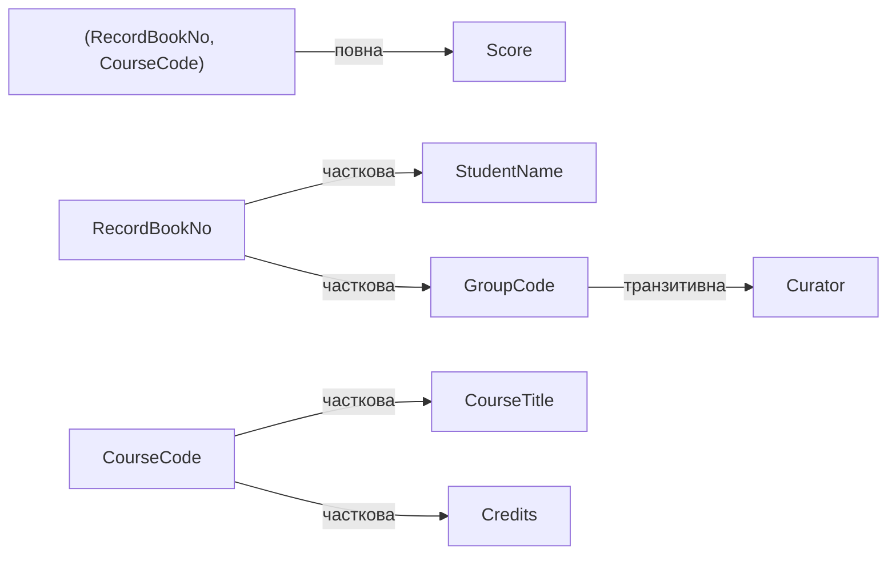

# Тема 4. Основи проектування реляційних баз даних

## 4.1. Поняття ключа. Основні типи ключів

**Ключ** — атрибут або набір атрибутів, значення яких однозначно ідентифікують кортеж
відношення.

| Тип ключа | Визначення | Приклад у UniversityDB |
|-----------|-----------|-------------------------|
| **Суперключ** | будь-який набір атрибутів з унікальними значеннями | (`StudentId`, `LastName`) |
| **Потенційний** (кандидатний) | мінімальний суперключ: жоден атрибут не можна вилучити | `StudentId`; `RecordBookNo` |
| **Первинний** (primary) | потенційний ключ, обраний основним | `Student.StudentId` |
| **Альтернативний** | потенційний ключ, не обраний первинним | `Student.RecordBookNo` (`UNIQUE`) |
| **Простий / складений** | з одного / з кількох атрибутів | `CourseId` / (`StudentId`, `TeachingId`) у `Grade` |
| **Природний** | має зміст у предметній області | номер залікової книжки, e-mail |
| **Сурогатний** | штучний, без змісту (лічильник, GUID) | `IDENTITY`-стовпці |
| **Зовнішній** (foreign) | атрибут, що посилається на первинний (альтернативний) ключ іншого відношення | `Student.GroupId` → `StudentGroup.GroupId` |

### Вимоги до ключів

1. **Унікальність** — немає двох кортежів з однаковим значенням ключа.
2. **Мінімальність** (нескоротність) — жоден атрибут не можна вилучити без втрати унікальності.
3. **Визначеність** — значення первинного ключа не може бути `NULL` (цілісність сутностей).
4. **Стабільність** — значення ключа не повинне змінюватися з часом (тому часто обирають
   сурогатний ключ: прізвище може змінитися, а `StudentId` — ні).
5. **Посилкова цілісність** для зовнішніх ключів — значення зовнішнього ключа або `NULL`,
   або існує у батьківському відношенні.

### Ключі в SQL Server

```sql
USE UniversityDB;

-- Усі первинні та унікальні ключі бази з переліком стовпців
SELECT OBJECT_NAME(kc.parent_object_id) AS TableName,
       kc.type_desc                     AS KeyType,
       kc.name                          AS KeyName,
       STRING_AGG(c.name, ', ') WITHIN GROUP (ORDER BY ic.key_ordinal) AS Columns
FROM sys.key_constraints AS kc
JOIN sys.index_columns AS ic ON ic.object_id = kc.parent_object_id AND ic.index_id = kc.unique_index_id
JOIN sys.columns       AS c  ON c.object_id  = ic.object_id AND c.column_id = ic.column_id
WHERE SCHEMA_NAME(kc.schema_id) = 'dbo'
GROUP BY kc.parent_object_id, kc.type_desc, kc.name
ORDER BY TableName, KeyType;
```

Чи може набір атрибутів бути потенційним ключем? Перевіримо унікальність на даних:

```sql
-- Прізвище — НЕ ключ? Шукаємо повтори (якщо результат порожній — на цих даних унікальне)
SELECT LastName, COUNT(*) AS Cnt
FROM dbo.Student
GROUP BY LastName
HAVING COUNT(*) > 1;

-- А місто — точно не ключ
SELECT City, COUNT(*) AS Cnt
FROM dbo.Student
GROUP BY City
HAVING COUNT(*) > 1;
```

!!! note "Ключ — властивість схеми, а не даних"
    Те, що прізвища в тестових даних не повторюються, ще не робить `LastName` ключем:
    у реальному університеті однофамільці неминучі. Ключ визначається **змістом**
    предметної області, а перевірка на даних може лише спростувати ключ.

Способи генерації сурогатних ключів:

```sql
-- 1) IDENTITY — лічильник, прив'язаний до таблиці
SELECT IDENT_CURRENT('dbo.Student') AS LastStudentId;

-- 2) SEQUENCE — незалежний генератор, можна використовувати в кількох таблицях
CREATE SEQUENCE dbo.seqRecordBook AS INT START WITH 25010001 INCREMENT BY 1;
SELECT NEXT VALUE FOR dbo.seqRecordBook AS NewRecordBookNo;
DROP SEQUENCE dbo.seqRecordBook;

-- 3) GUID — глобально унікальний (зручно для розподілених БД, Тема 9)
SELECT NEWID() AS RandomGuid, NEWSEQUENTIALID_DemoNote = N'NEWSEQUENTIALID() — лише в DEFAULT';
```

Цілісність сутностей і посилкова цілісність:

```sql
-- Помилка: повтор первинного ключа
INSERT INTO dbo.Grade (StudentId, TeachingId, Score, ExamDate) VALUES (1, 1, 90, '2025-01-20');

-- Помилка: не можна видалити групу, у якій є студенти (посилкова цілісність)
DELETE FROM dbo.StudentGroup WHERE Code = N'ПІ-21';

-- Можна: у групи ФН-24 немає залежних рядків
-- (виконуємо в транзакції і відкочуємо, щоб не змінювати тестові дані)
BEGIN TRAN;
    DELETE FROM dbo.StudentGroup WHERE Code = N'ФН-24';
    SELECT @@ROWCOUNT AS Deleted;
ROLLBACK;
```

Дії при видаленні/оновленні батьківського рядка задаються в `FOREIGN KEY`:
`NO ACTION` (за замовчуванням — заборонити), `CASCADE`, `SET NULL`, `SET DEFAULT`.

```sql
CREATE TABLE dbo.Parent (Id INT PRIMARY KEY);
CREATE TABLE dbo.Child  (Id INT PRIMARY KEY,
                         ParentId INT REFERENCES dbo.Parent(Id) ON DELETE CASCADE);
INSERT INTO dbo.Parent VALUES (1), (2);
INSERT INTO dbo.Child  VALUES (10, 1), (11, 1), (20, 2);

DELETE FROM dbo.Parent WHERE Id = 1;
SELECT * FROM dbo.Child;          -- залишився лише рядок 20: дочірні видалено каскадно

DROP TABLE dbo.Child, dbo.Parent;
```

## 4.2. Основи реляційної алгебри

**Реляційна алгебра** — набір операцій над відношеннями, результат кожної з яких —
теж відношення. Це математична основа мови SQL.

| Операція | Позначення | SQL |
|----------|:----------:|-----|
| Об'єднання | R ∪ S | `UNION` |
| Різниця | R − S | `EXCEPT` |
| Перетин | R ∩ S | `INTERSECT` |
| Декартовий добуток | R × S | `CROSS JOIN` |
| Селекція (вибірка) | σ<sub>умова</sub>(R) | `WHERE` |
| Проекція | π<sub>атрибути</sub>(R) | `SELECT DISTINCT` список стовпців |
| З'єднання | R ⋈<sub>умова</sub> S | `JOIN ... ON` |
| Ділення | R ÷ S | `NOT EXISTS ... NOT EXISTS` |

Операції **об'єднання, різниці та перетину** вимагають **сумісності за об'єднанням**:
однакова кількість атрибутів і сумісні домени.

Підготуємо два відношення: студенти з Києва (R) і бюджетники (S).

=== "Об'єднання R ∪ S"

    ```sql
    -- Студенти з Києва АБО бюджетники (дублікати усуваються)
    SELECT StudentId, LastName FROM dbo.Student WHERE City = N'Київ'
    UNION
    SELECT StudentId, LastName FROM dbo.Student WHERE IsContract = 0;
    ```

=== "Різниця R − S"

    ```sql
    -- Студенти з Києва, які НЕ є бюджетниками
    SELECT StudentId, LastName FROM dbo.Student WHERE City = N'Київ'
    EXCEPT
    SELECT StudentId, LastName FROM dbo.Student WHERE IsContract = 0;
    ```

=== "Перетин R ∩ S"

    ```sql
    -- Студенти з Києва, які є бюджетниками
    -- (R ∩ S = R − (R − S))
    SELECT StudentId, LastName FROM dbo.Student WHERE City = N'Київ'
    INTERSECT
    SELECT StudentId, LastName FROM dbo.Student WHERE IsContract = 0;
    ```

=== "Декартовий добуток R × S"

    ```sql
    -- Усі можливі пари «факультет × семестр»: 2 × 2 = 4 кортежі
    SELECT f.ShortName, s.Semester
    FROM dbo.Faculty AS f
    CROSS JOIN (VALUES (1), (2)) AS s(Semester);
    ```

=== "Селекція σ"

    ```sql
    -- σ Score >= 90 (Grade): горизонтальна підмножина — відбираємо рядки
    SELECT * FROM dbo.Grade WHERE Score >= 90;
    ```

=== "Проекція π"

    ```sql
    -- π City (Student): вертикальна підмножина — відбираємо стовпці
    -- DISTINCT обов'язковий: результат відношення не має дублікатів
    SELECT DISTINCT City FROM dbo.Student;
    ```

**З'єднання** — це декартовий добуток із подальшою селекцією:
R ⋈<sub>R.a = S.b</sub> S = σ<sub>R.a = S.b</sub>(R × S). Обидва запити нижче
еквівалентні:

```sql
-- Через декартовий добуток і селекцію
SELECT s.LastName, g.Code
FROM dbo.Student AS s CROSS JOIN dbo.StudentGroup AS g
WHERE s.GroupId = g.GroupId;

-- Через операцію з'єднання
SELECT s.LastName, g.Code
FROM dbo.Student AS s JOIN dbo.StudentGroup AS g ON s.GroupId = g.GroupId;
```

**Композиція операцій**: π<sub>LastName, Title</sub>(σ<sub>Score ≥ 90</sub>(Student ⋈ Grade ⋈ Teaching ⋈ Course)) —
«хто з яких дисциплін отримав A»:

```sql
SELECT DISTINCT s.LastName, c.Title
FROM dbo.Student  AS s
JOIN dbo.Grade    AS g ON g.StudentId  = s.StudentId
JOIN dbo.Teaching AS t ON t.TeachingId = g.TeachingId
JOIN dbo.Course   AS c ON c.CourseId   = t.CourseId
WHERE g.Score >= 90;
```

**Ділення** R ÷ S відповідає на питання з квантором «для всіх». Які групи вивчають
**усі** дисципліни 1-го семестру, що читаються групі ПІ-21?

```sql
-- R: (група, дисципліна);  S: дисципліни 1-го семестру групи ПІ-21
-- Група входить у результат, якщо НЕ існує дисципліни з S, якої НЕМАЄ в цієї групи
SELECT g.Code
FROM dbo.StudentGroup AS g
WHERE NOT EXISTS (
        SELECT 1
        FROM dbo.Teaching AS s
        WHERE s.GroupId = 1 AND s.Semester = 1
          AND NOT EXISTS (SELECT 1
                          FROM dbo.Teaching AS r
                          WHERE r.GroupId = g.GroupId
                            AND r.CourseId = s.CourseId));
```

??? example "Результат"
    | Code |
    |------|
    | ПІ-21 |
    | ПІ-22 |

## 4.3. Нормалізація схем баз даних

**Нормалізація** — процес перетворення відношень у форму, що усуває надлишковість і
аномалії (вставки, оновлення, видалення) шляхом **декомпозиції без втрат**.

**Мета нормалізації**:

* усунути дублювання даних;
* усунути аномалії модифікації;
* спростити підтримку цілісності;
* отримати структуру, стійку до змін предметної області.

### Функціональні залежності

Атрибут **B функціонально залежить** від A (A → B), якщо кожному значенню A відповідає
рівно одне значення B. Наприклад, `RecordBookNo → LastName`, `CourseCode → Credits`.

* **Повна** залежність — B залежить від усього складеного ключа, а не від його частини.
* **Часткова** залежність — B залежить від частини складеного ключа.
* **Транзитивна** залежність — A → B і B → C, де B не є ключем; тоді A → C транзитивно.

Перевірити, чи виконується залежність A → B на даних, можна запитом: якщо для якогось
значення A є кілька різних B, залежність порушена.

```sql
-- Чи виконується GroupCode → Department? (порожній результат = так)
SELECT g.Code, COUNT(DISTINCT g.DepartmentId) AS Departments
FROM dbo.StudentGroup AS g
GROUP BY g.Code
HAVING COUNT(DISTINCT g.DepartmentId) > 1;
```

### Етапи нормалізації на прикладі

Почнемо з **ненормалізованої** відомості, де в одній клітинці кілька значень:

```sql
CREATE SCHEMA norm;
GO

CREATE TABLE norm.Unnormalized (
    RecordBookNo CHAR(8),
    StudentName  NVARCHAR(100),
    GroupCode    NVARCHAR(10),
    Curator      NVARCHAR(50),
    Courses      NVARCHAR(400)    -- «повторювана група» в одному полі
);

INSERT INTO norm.Unnormalized VALUES
 ('21010001', N'Петренко Іван',  N'ПІ-21', N'Бондар',
  N'MATH101:Вища математика:6:55; PRG101:Основи програмування:5:84'),
 ('21010002', N'Іваненко Олена', N'ПІ-21', N'Бондар',
  N'MATH101:Вища математика:6:72; PRG101:Основи програмування:5:55'),
 ('22010001', N'Захарченко Софія', N'ПІ-22', N'Ткаченко',
  N'PRG101:Основи програмування:5:98');

SELECT * FROM norm.Unnormalized;
```

Таку таблицю неможливо нормально запитувати: як знайти всі оцінки з «Вищої математики»
чи середній бал? Значення **не атомарні**.

#### Перша нормальна форма (1НФ)

> Відношення в **1НФ**, якщо всі його атрибути містять лише **атомарні** значення
> (немає повторюваних груп і складених значень).

Розкладемо поле `Courses` на окремі рядки:

```sql
SELECT u.RecordBookNo, u.StudentName, u.GroupCode, u.Curator,
       PARSENAME(REPLACE(LTRIM(c.value), ':', '.'), 4) AS CourseCode,
       PARSENAME(REPLACE(LTRIM(c.value), ':', '.'), 3) AS CourseTitle,
       CAST(PARSENAME(REPLACE(LTRIM(c.value), ':', '.'), 2) AS DECIMAL(3,1)) AS Credits,
       CAST(PARSENAME(REPLACE(LTRIM(c.value), ':', '.'), 1) AS TINYINT)      AS Score
INTO norm.Grades1NF
FROM norm.Unnormalized AS u
CROSS APPLY STRING_SPLIT(u.Courses, ';') AS c;

ALTER TABLE norm.Grades1NF ALTER COLUMN RecordBookNo CHAR(8) NOT NULL;
ALTER TABLE norm.Grades1NF ALTER COLUMN CourseCode VARCHAR(10) NOT NULL;
ALTER TABLE norm.Grades1NF ADD CONSTRAINT PK_Grades1NF PRIMARY KEY (RecordBookNo, CourseCode);

SELECT * FROM norm.Grades1NF;
```

??? example "Результат: відношення в 1НФ, ключ (RecordBookNo, CourseCode)"
    | RecordBookNo | StudentName | GroupCode | Curator | CourseCode | CourseTitle | Credits | Score |
    |---|---|---|---|---|---|---:|---:|
    | 21010001 | Петренко Іван | ПІ-21 | Бондар | MATH101 | Вища математика | 6.0 | 55 |
    | 21010001 | Петренко Іван | ПІ-21 | Бондар | PRG101 | Основи програмування | 5.0 | 84 |
    | 21010002 | Іваненко Олена | ПІ-21 | Бондар | MATH101 | Вища математика | 6.0 | 72 |
    | 21010002 | Іваненко Олена | ПІ-21 | Бондар | PRG101 | Основи програмування | 5.0 | 55 |
    | 22010001 | Захарченко Софія | ПІ-22 | Ткаченко | PRG101 | Основи програмування | 5.0 | 98 |

Функціональні залежності в `Grades1NF`:



Аномалії 1НФ: назва дисципліни повторюється для кожного студента (аномалія оновлення);
не можна додати дисципліну без оцінки (аномалія вставки); видалення єдиної оцінки
Захарченко видалить і дані про неї (аномалія видалення).

#### Друга нормальна форма (2НФ)

> Відношення в **2НФ**, якщо воно в 1НФ і кожен неключовий атрибут **повністю**
> функціонально залежить від первинного ключа (немає часткових залежностей).

Виносимо атрибути, що залежать від частини ключа, в окремі відношення:

```sql
SELECT DISTINCT RecordBookNo, StudentName, GroupCode, Curator
INTO norm.Student2NF FROM norm.Grades1NF;

SELECT DISTINCT CourseCode, CourseTitle, Credits
INTO norm.Course2NF FROM norm.Grades1NF;

SELECT RecordBookNo, CourseCode, Score
INTO norm.Grade2NF FROM norm.Grades1NF;

SELECT * FROM norm.Student2NF;
SELECT * FROM norm.Course2NF;
```

#### Третя нормальна форма (3НФ)

> Відношення в **3НФ**, якщо воно в 2НФ і жоден неключовий атрибут не залежить
> **транзитивно** від первинного ключа.

У `Student2NF` є транзитивна залежність `RecordBookNo → GroupCode → Curator`: куратор —
властивість групи, а не студента. Якщо куратор зміниться, доведеться оновлювати всіх
студентів групи. Виносимо групу в окреме відношення:

```sql
SELECT DISTINCT GroupCode, Curator INTO norm.Group3NF FROM norm.Student2NF;

SELECT RecordBookNo, StudentName, GroupCode INTO norm.Student3NF FROM norm.Student2NF;

SELECT * FROM norm.Group3NF;
```

**Декомпозиція без втрат**: з'єднання нормалізованих відношень дає рівно вихідне
відношення — перевіримо операцією різниці в обидва боки (обидва запити повертають 0 рядків):

```sql
WITH Restored AS (
    SELECT s.RecordBookNo, s.StudentName, s.GroupCode, g.Curator,
           c.CourseCode, c.CourseTitle, c.Credits, gr.Score
    FROM norm.Grade2NF   AS gr
    JOIN norm.Student3NF AS s ON s.RecordBookNo = gr.RecordBookNo
    JOIN norm.Group3NF   AS g ON g.GroupCode    = s.GroupCode
    JOIN norm.Course2NF  AS c ON c.CourseCode   = gr.CourseCode
)
SELECT 'зайві рядки' AS CheckName, COUNT(*) AS Cnt
FROM (SELECT * FROM Restored EXCEPT SELECT * FROM norm.Grades1NF) AS x
UNION ALL
SELECT 'втрачені рядки', COUNT(*)
FROM (SELECT * FROM norm.Grades1NF EXCEPT SELECT * FROM Restored) AS y;
```

Схема `UniversityDB` спроектована саме так: `Student`, `StudentGroup`, `Course`, `Grade` — це
відношення в 3НФ (і навіть у НФБК).

#### Нормальна форма Бойса — Кодда (НФБК)

> Відношення в **НФБК**, якщо **детермінант кожної** нетривіальної функціональної
> залежності є потенційним ключем.

3НФ не гарантує НФБК, коли є **кілька складених потенційних ключів, що перетинаються**.
Класичний приклад: кожен викладач веде лише одну дисципліну, а студент з кожної
дисципліни прикріплений до одного викладача.

```sql
CREATE TABLE norm.Consultation (
    Student NVARCHAR(50) NOT NULL,
    Course  NVARCHAR(50) NOT NULL,
    Teacher NVARCHAR(50) NOT NULL,
    PRIMARY KEY (Student, Course)
);

INSERT INTO norm.Consultation VALUES
 (N'Петренко',  N'Бази даних',  N'Шевченко'),
 (N'Іваненко',  N'Бази даних',  N'Шевченко'),
 (N'Левченко',  N'Бази даних',  N'Бондар'),
 (N'Петренко',  N'Алгоритми',   N'Кравченко');
```

Залежності: (`Student`, `Course`) → `Teacher` і `Teacher` → `Course`.
Потенційні ключі: (`Student`, `Course`) і (`Student`, `Teacher`). Усі атрибути ключові,
тому відношення в 3НФ, але детермінант `Teacher` — не ключ, отже **НФБК порушено**.
Аномалія: неможливо записати, що Олійник веде «Бази даних», доки до нього не прикріплено
студента. Декомпозиція до НФБК:

```sql
SELECT DISTINCT Teacher, Course INTO norm.TeacherCourse    FROM norm.Consultation;  -- ключ: Teacher
SELECT DISTINCT Student, Teacher INTO norm.StudentTeacher  FROM norm.Consultation;  -- ключ: (Student, Teacher)

INSERT INTO norm.TeacherCourse VALUES (N'Олійник', N'Бази даних');  -- тепер це можливо

SELECT * FROM norm.TeacherCourse;
```

### Властивості нормальних форм (підсумок)

| НФ | Вимога | Що усуває |
|----|--------|-----------|
| 1НФ | атомарні значення | повторювані групи |
| 2НФ | 1НФ + немає часткових залежностей від ключа | дублювання даних про частину ключа |
| 3НФ | 2НФ + немає транзитивних залежностей | дублювання даних про неключові атрибути |
| НФБК | кожен детермінант — потенційний ключ | аномалії при перетині складених ключів |
| 4НФ | НФБК + немає нетривіальних багатозначних залежностей | незалежні множинні факти в одній таблиці |
| 5НФ | немає залежностей з'єднання | надлишковість, яку не можна усунути розбиттям на 2 частини |

Кожна наступна форма містить попередню: 5НФ ⊂ 4НФ ⊂ НФБК ⊂ 3НФ ⊂ 2НФ ⊂ 1НФ.

### Критерії вибору нормальної форми

* Для **транзакційних (OLTP)** систем з частими змінами даних зазвичай достатньо
  **3НФ / НФБК**: мінімальна надлишковість, прості оновлення.
* Для **аналітичних** систем і звітів (OLAP, сховища даних) часто застосовують
  **денормалізацію** — свідоме повернення надлишковості заради швидших запитів
  (схеми «зірка», «сніжинка»).
* Чим вища НФ, тим більше таблиць і з'єднань у запитах, тож треба зважувати
  **швидкість читання** проти **простоти та надійності оновлення**.

Приклад контрольованої денормалізації в SQL Server — **індексоване представлення**,
яке зберігає попередньо обчислені агрегати, а СКБД сама підтримує їх актуальність:

```sql
CREATE VIEW dbo.vCourseStats
WITH SCHEMABINDING
AS
SELECT t.CourseId,
       COUNT_BIG(*)        AS GradeCount,
       SUM(CAST(g.Score AS INT)) AS ScoreSum
FROM dbo.Grade AS g
JOIN dbo.Teaching AS t ON t.TeachingId = g.TeachingId
GROUP BY t.CourseId;
GO

CREATE UNIQUE CLUSTERED INDEX IX_vCourseStats ON dbo.vCourseStats(CourseId);
GO

SELECT c.Title, v.GradeCount, v.ScoreSum * 1.0 / v.GradeCount AS AvgScore
FROM dbo.vCourseStats AS v WITH (NOEXPAND)
JOIN dbo.Course AS c ON c.CourseId = v.CourseId;
```

## Контрольні питання

1. Чим потенційний ключ відрізняється від суперключа? Наведіть приклади.
2. Які вимоги висуваються до первинного ключа? Чому часто обирають сурогатний ключ?
3. Як операції реляційної алгебри (об'єднання, різниця, декартовий добуток, проекція,
   селекція) записуються мовою SQL?
4. Що таке функціональна, часткова і транзитивна залежності?
5. Сформулюйте означення 1НФ, 2НФ, 3НФ і НФБК.
6. Наведіть приклад відношення в 3НФ, але не в НФБК.
7. Як перевірити, що декомпозиція відбулася без втрат?
8. Коли доцільна денормалізація?
