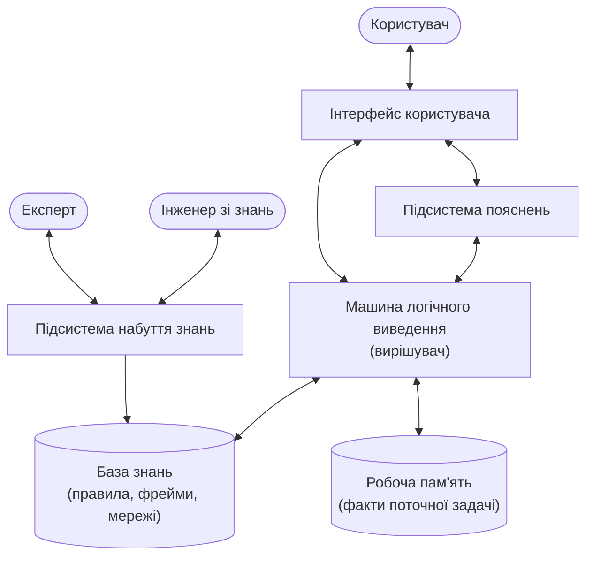
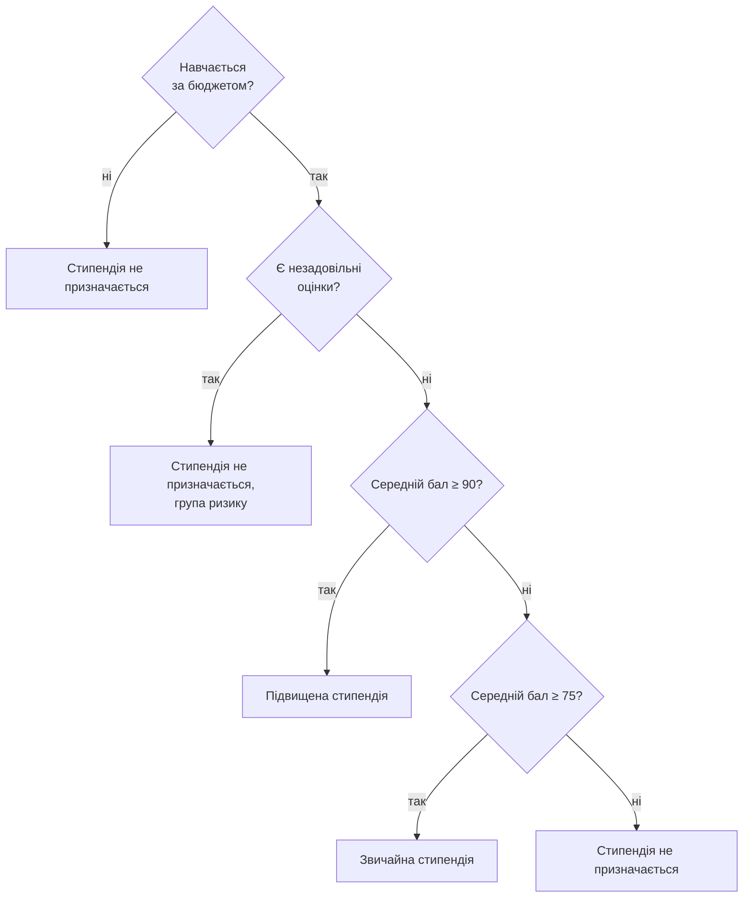
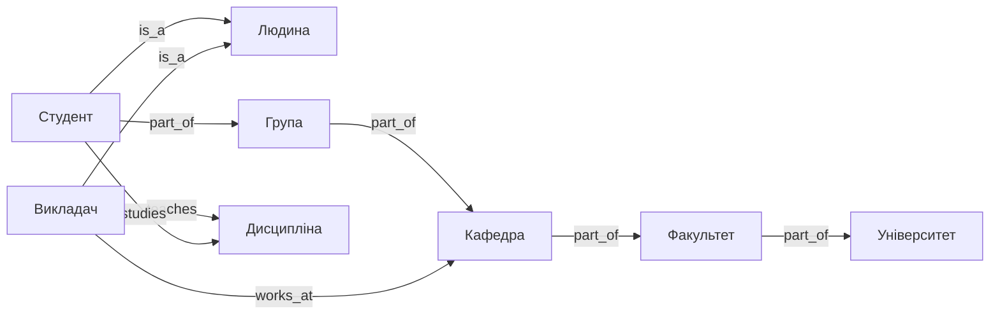
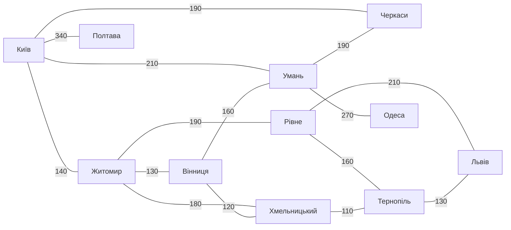

# Тема 6. Організація баз знань

!!! info "Підготовка"
    Приклади цієї теми використовують схему `kb`. Виконайте скрипт
    [03_knowledge_base.sql](../sql/03_knowledge_base.sql), якщо ще цього не зробили.

## 6.1. Поняття експертних систем

**Знання** — це закономірності предметної області (принципи, зв'язки, правила), отримані
в результаті практичної діяльності та професійного досвіду, які дозволяють ставити й
розв'язувати задачі. На відміну від даних, знання дають змогу **виводити** нову інформацію.

**Експертна система (ЕС)** — програмна система, що використовує знання експертів для
розв'язання задач у вузькій предметній області на рівні фахівця (діагностика,
прогнозування, планування, консультування). Класичні приклади: MYCIN (медична
діагностика), DENDRAL (хімія), XCON (конфігурування комп'ютерів).

**Система обробки знань (СОЗ)** — загальна назва систем, що зберігають знання та
виконують над ними логічне виведення.

### Структура експертної системи



* **База знань** — довготривалі знання про предметну область (правила, фрейми).
* **Робоча пам'ять** (база даних ЕС) — факти конкретної задачі, що розв'язується.
* **Машина виведення** — застосовує знання до фактів і отримує нові факти.
* **Підсистема пояснень** — відповідає на питання «як отримано висновок?» і «чому
  задається це питання?».
* **Підсистема набуття знань** — інструменти для поповнення та коригування бази знань.

## 6.2. Отримання і формалізація знань

Етапи роботи **інженера зі знань**:

1. **Ідентифікація** — визначення задачі, джерел знань, учасників.
2. **Отримання (виявлення) знань** — інтерв'ю з експертами, аналіз документів,
   спостереження, анкетування, машинне навчання на даних.
3. **Структурування** — виділення понять, зв'язків, стратегій прийняття рішень.
4. **Формалізація** — запис знань мовою подання знань (логіка, правила, фрейми, мережі).
5. **Реалізація і тестування** прототипу ЕС.

### Дерево рішень задачі

**Дерево рішень** — зручна форма структурування знань експерта: внутрішні вузли —
перевірки умов, гілки — результати перевірок, листки — рішення.
Експерт деканату описує призначення стипендії так:



### Формування правил

Кожен шлях від кореня до листка дерева рішень — це **правило** «ЯКЩО умови ТО висновок»:

* ЯКЩО контракт ТО стипендії немає;
* ЯКЩО бюджет І є незадовільні ТО стипендії немає, група ризику;
* ЯКЩО бюджет І немає незадовільних І бал ≥ 90 ТО підвищена стипендія;
* …

Дерево рішень безпосередньо перекладається у вираз `CASE`:

```sql
USE UniversityDB;

WITH Perf AS (
    SELECT s.StudentId, s.LastName, s.IsContract,
           AVG(CAST(g.Score AS DECIMAL(5,2)))          AS AvgScore,
           SUM(CASE WHEN g.Score < 60 THEN 1 ELSE 0 END) AS Fails
    FROM dbo.Student AS s
    JOIN dbo.Grade   AS g ON g.StudentId = s.StudentId
    WHERE s.IsActive = 1
    GROUP BY s.StudentId, s.LastName, s.IsContract
)
SELECT LastName, AvgScore, Fails,
       CASE
           WHEN IsContract = 1  THEN N'не призначається (контракт)'
           WHEN Fails > 0       THEN N'не призначається, група ризику'
           WHEN AvgScore >= 90  THEN N'підвищена'
           WHEN AvgScore >= 75  THEN N'звичайна'
           ELSE                      N'не призначається (низький бал)'
       END AS Decision
FROM Perf
ORDER BY LastName;
```

## 6.3. Представлення знань з використанням логіки предикатів

**Предикат** — функція, що повертає «істина» або «хибність»: `Студент(x)`,
`Навчається(x, g)`, `Оцінка(x, d, b)`.

**Предикатна формула** будується з предикатів за допомогою логічних зв'язок
(∧ «і», ∨ «або», ¬ «не», → «якщо…то») і **кванторів** ∀ («для всіх») та ∃ («існує»).

Приклади знань у вигляді формул:

* ∀x (Студент(x) → Людина(x)) — кожен студент є людиною;
* ∀x (Відмінник(x) ↔ Студент(x) ∧ ∀d ∀b (Оцінка(x, d, b) → b ≥ 90)) — відмінник має всі оцінки ≥ 90;
* ∀x ∀z (Вимагає(x, z) ← ∃y (Вимагає(x, y) ∧ Вимагає(y, z))) — транзитивність пререквізитів.

Реляційна БД — це, по суті, набір істинних фактів (кожен рядок — істинний предикат), а
SQL — мова логіки предикатів першого порядку: ∃ ↔ `EXISTS`, ∀ ↔ `NOT EXISTS (... NOT ...)`.

```sql
-- ∃: студенти, які мають хоча б одну оцінку A (Score >= 90)
SELECT s.LastName
FROM dbo.Student AS s
WHERE EXISTS (SELECT 1 FROM dbo.Grade AS g WHERE g.StudentId = s.StudentId AND g.Score >= 90);

-- ∀: студенти, у яких УСІ оцінки >= 65 (немає жодної оцінки < 65)
-- ∀d (Оцінка(x,d,b) → b >= 65)  ≡  ¬∃d (Оцінка(x,d,b) ∧ b < 65)
SELECT s.LastName
FROM dbo.Student AS s
WHERE EXISTS (SELECT 1 FROM dbo.Grade AS g WHERE g.StudentId = s.StudentId)
  AND NOT EXISTS (SELECT 1 FROM dbo.Grade AS g WHERE g.StudentId = s.StudentId AND g.Score < 65);
```

## 6.4. Семантичні мережі

**Семантична мережа** — орієнтований граф, вершини якого — **поняття** (об'єкти,
події, властивості), а дуги — **семантичні відношення** між ними.

### Класифікація семантичних відношень

| Група | Відношення | Приклад |
|-------|-----------|---------|
| Класифікаційні | **is_a** («є», «є різновидом»), **instance_of** («є екземпляром») | Студент is_a Людина |
| Агрегаційні | **part_of** / **has_part** («є частиною» / «має частину») | Група part_of Кафедра |
| Атрибутивні | **has_property** («має властивість») | Студент has_property Середній бал |
| Функціональні | дієслівні: **teaches**, **studies**, **works_at** | Викладач teaches Дисципліна |
| Кількісні | більше, менше, дорівнює | Кредити(БД) > Кредити(Фінанси) |
| Просторові | далеко, поруч, над, під | Корпус 1 поруч з Корпусом 2 |
| Часові | раніше, пізніше, під час | Алгоритми раніше ШІ |
| Логічні | і, або, не | — |



Мережа зберігається в графових таблицях `kb.Concept` (вершини) і `kb.Link` (дуги).
Пошук у семантичній мережі — це пошук зразка (підграфа) оператором `MATCH`:

```sql
-- Усі зв'язки поняття «Студент»
SELECT a.Name AS Subject, l.RelType AS Relation, b.Name AS Object
FROM kb.Concept AS a, kb.Link AS l, kb.Concept AS b
WHERE MATCH(a-(l)->b) AND a.Name = N'Студент';

-- Зразок: «хто викладає те, що вивчає студент?»
SELECT t.Name AS Who, d.Name AS What
FROM kb.Concept AS s, kb.Link AS l1, kb.Concept AS d, kb.Link AS l2, kb.Concept AS t
WHERE MATCH(s-(l1)->d<-(l2)-t)
  AND s.Name = N'Студент' AND l1.RelType = N'studies' AND l2.RelType = N'teaches';

-- Транзитивне виведення по part_of: частиною чого (на будь-якому рівні) є Група?
SELECT g.Name,
       STRING_AGG(x.Name, N' → ') WITHIN GROUP (GRAPH PATH) AS PartOfChain
FROM kb.Concept AS g,
     kb.Link FOR PATH AS l,
     kb.Concept FOR PATH AS x
WHERE MATCH(SHORTEST_PATH(g(-(l)->x)+)) AND g.Name = N'Група';
```

??? example "Результат останнього запиту"
    | Name | PartOfChain |
    |------|-------------|
    | Група | Кафедра |
    | Група | Кафедра → Факультет |
    | Група | Кафедра → Факультет → Університет |

## 6.5. Продукційні моделі

**Продукційна модель** подає знання у вигляді правил-**продукцій**:

> **ЯКЩО** умова (антецедент) **ТО** дія або висновок (консеквент)

Продукційна система складається з **бази правил**, **робочої пам'яті** (фактів) і
**інтерпретатора правил**. Цикл роботи інтерпретатора: *зіставлення* (знайти правила,
умови яких виконуються) → *вибір* (розв'язання конфліктів) → *виконання* (додати висновок у
робочу пам'ять) → повтор, доки нові факти з'являються.

База правил у `kb.Rule` / `kb.RuleCondition`:

```sql
SELECT r.RuleId,
       N'ЯКЩО ' + STRING_AGG(CAST(c.FactCode AS NVARCHAR(30)), N' І ') + N' ТО ' + r.ConclusionCode AS RuleText,
       r.Certainty
FROM kb.[Rule] AS r
JOIN kb.RuleCondition AS c ON c.RuleId = r.RuleId
GROUP BY r.RuleId, r.ConclusionCode, r.Certainty
ORDER BY r.RuleId;
```

??? example "Результат"
    | RuleId | RuleText | Certainty |
    |-------:|----------|----------:|
    | 1 | ЯКЩО avg_ge_90 І no_fails ТО excellent | 1.00 |
    | 2 | ЯКЩО avg_ge_75 І budget І no_fails ТО scholarship | 1.00 |
    | 3 | ЯКЩО excellent І scholarship І social_activity ТО high_scholarship | 0.90 |
    | 4 | ЯКЩО has_fails ТО risk | 0.80 |

### Прямий ланцюжок міркувань (від фактів до цілі)

Спочатку заповнимо **робочу пам'ять** вихідними фактами, обчисленими з БД:

```sql
CREATE TABLE #WM (                 -- робоча пам'ять
    StudentId INT,
    FactCode  VARCHAR(30) COLLATE DATABASE_DEFAULT,   -- tempdb може мати інше правило сортування
    RuleId    INT NULL,            -- яким правилом отримано (NULL — вихідний факт)
    PRIMARY KEY (StudentId, FactCode)
);

WITH Perf AS (
    SELECT s.StudentId, s.IsContract,
           AVG(CAST(g.Score AS DECIMAL(5,2)))           AS AvgScore,
           SUM(CASE WHEN g.Score < 60 THEN 1 ELSE 0 END) AS Fails
    FROM dbo.Student AS s
    JOIN dbo.Grade AS g ON g.StudentId = s.StudentId
    WHERE s.IsActive = 1
    GROUP BY s.StudentId, s.IsContract
)
INSERT INTO #WM (StudentId, FactCode)
SELECT StudentId, f.FactCode
FROM Perf
CROSS APPLY (VALUES
    (CASE WHEN AvgScore >= 90 THEN 'avg_ge_90' END),
    (CASE WHEN AvgScore >= 75 THEN 'avg_ge_75' END),
    (CASE WHEN Fails = 0 THEN 'no_fails' ELSE 'has_fails' END),
    (CASE WHEN IsContract = 0 THEN 'budget' END)
) AS f(FactCode)
WHERE f.FactCode IS NOT NULL;

-- Дані опитування: хто бере участь у громадському житті
INSERT INTO #WM (StudentId, FactCode) VALUES (2, 'social_activity'), (12, 'social_activity'), (14, 'social_activity');

-- Щоб побачити ланцюжок із кількох кроків, додамо факт від експерта:
-- студентку Яковенко (12) атестовано як відмінницю за результатами олімпіади
INSERT INTO #WM (StudentId, FactCode) VALUES (12, 'avg_ge_90');
```

**Машина прямого виведення**: на кожній ітерації додаємо висновки всіх правил, усі
умови яких уже є в робочій пам'яті; зупиняємося, коли нових фактів немає.

```sql
DECLARE @step INT = 0, @added INT = 1;

WHILE @added > 0
BEGIN
    SET @step += 1;

    INSERT INTO #WM (StudentId, FactCode, RuleId)
    SELECT DISTINCT w.StudentId, r.ConclusionCode, r.RuleId
    FROM (SELECT DISTINCT StudentId FROM #WM) AS w
    CROSS JOIN kb.[Rule] AS r
    WHERE NOT EXISTS (SELECT 1 FROM #WM AS x              -- висновку ще немає
                      WHERE x.StudentId = w.StudentId AND x.FactCode = r.ConclusionCode)
      AND NOT EXISTS (SELECT 1 FROM kb.RuleCondition AS c  -- і всі умови виконані
                      WHERE c.RuleId = r.RuleId
                        AND NOT EXISTS (SELECT 1 FROM #WM AS y
                                        WHERE y.StudentId = w.StudentId AND y.FactCode = c.FactCode));

    SET @added = @@ROWCOUNT;
    PRINT CONCAT(N'Крок ', @step, N': нових фактів — ', @added);
END;

-- Підсистема пояснень: які висновки і якими правилами отримано
SELECT s.LastName, w.FactCode, f.Description, w.RuleId
FROM #WM AS w
JOIN dbo.Student AS s ON s.StudentId = w.StudentId
JOIN kb.Fact     AS f ON f.FactCode  = w.FactCode
WHERE w.RuleId IS NOT NULL
ORDER BY s.LastName, w.RuleId;
```

??? example "Результат"
    ```text
    Крок 1: нових фактів — 9
    Крок 2: нових фактів — 1      ← правило 3 спрацювало на висновках кроку 1
    Крок 3: нових фактів — 0
    ```

    | LastName | FactCode | Description | RuleId |
    |----------|----------|-------------|-------:|
    | Гончаренко | risk | Група ризику (потребує консультацій) | 4 |
    | Захарченко | risk | Група ризику (потребує консультацій) | 4 |
    | Іваненко | risk | Група ризику (потребує консультацій) | 4 |
    | Петренко | risk | Група ризику (потребує консультацій) | 4 |
    | Сидоренко | risk | Група ризику (потребує консультацій) | 4 |
    | Федоренко | scholarship | Має право на академічну стипендію | 2 |
    | Харченко | scholarship | Має право на академічну стипендію | 2 |
    | Яковенко | excellent | Відмінник | 1 |
    | Яковенко | scholarship | Має право на академічну стипендію | 2 |
    | Яковенко | high_scholarship | Має право на підвищену стипендію | 3 |

### Зворотний ланцюжок міркувань (від цілі до фактів)

При **зворотному** виведенні машина починає з **гіпотези** (цілі) і шукає правила, що її
доводять; умови цих правил стають новими **підцілями**, і так рекурсивно, доки не дійдемо
до відомих фактів. Так працювала MYCIN. Це ефективніше, коли цілей мало, а фактів багато.

```sql
CREATE OR ALTER PROCEDURE kb.Prove
    @StudentId INT,
    @Goal      VARCHAR(30),
    @Result    BIT OUTPUT,
    @Level     INT = 0
AS
BEGIN
    SET NOCOUNT ON;
    DECLARE @indent NVARCHAR(40) = REPLICATE(N'    ', @Level);

    IF EXISTS (SELECT 1 FROM #WM WHERE StudentId = @StudentId AND FactCode = @Goal)
    BEGIN
        PRINT @indent + @Goal + N' — відомий факт ✔';
        SET @Result = 1;
        RETURN;
    END;

    SET @Result = 0;
    DECLARE @RuleId INT = 0, @Cond VARCHAR(30), @Ok BIT, @Sub BIT, @NextLevel INT = @Level + 1;

    -- перебираємо правила, висновок яких збігається з ціллю
    WHILE @Result = 0
    BEGIN
        SELECT @RuleId = MIN(RuleId) FROM kb.[Rule] WHERE ConclusionCode = @Goal AND RuleId > @RuleId;
        IF @RuleId IS NULL BREAK;

        PRINT CONCAT(@indent, @Goal, N' ← правило ', @RuleId, N'?');
        SELECT @Ok = 1, @Cond = '';

        -- кожна умова правила стає підціллю
        WHILE @Ok = 1
        BEGIN
            SELECT @Cond = MIN(FactCode) FROM kb.RuleCondition WHERE RuleId = @RuleId AND FactCode > @Cond;
            IF @Cond IS NULL BREAK;
            EXEC kb.Prove @StudentId, @Cond, @Sub OUTPUT, @NextLevel;
            IF @Sub = 0 SET @Ok = 0;
        END;

        IF @Ok = 1
        BEGIN
            SET @Result = 1;
            INSERT INTO #WM (StudentId, FactCode, RuleId) VALUES (@StudentId, @Goal, @RuleId);
            PRINT @indent + @Goal + N' — доведено ✔';
        END;
    END;

    IF @Result = 0 PRINT @indent + @Goal + N' — не доведено ✘';
END;
GO

-- Чи має Федоренко (14) право на підвищену стипендію?
DELETE FROM #WM WHERE RuleId IS NOT NULL;   -- очищуємо висновки прямого виведення
DECLARE @r BIT;
EXEC kb.Prove @StudentId = 14, @Goal = 'high_scholarship', @Result = @r OUTPUT;
SELECT @r AS Proved;
```

??? example "Повідомлення (дерево доведення)"
    ```text
    high_scholarship ← правило 3?
        excellent ← правило 1?
            avg_ge_90 — не доведено ✘
        excellent — не доведено ✘
    high_scholarship — не доведено ✘
    ```
    Студентка має середній бал нижче 90, тому ціль не доведено. Спробуйте
    `@StudentId = 12` (Яковенко) — для неї ціль буде доведено.

!!! note "Тимчасова таблиця"
    `#WM` існує лише в поточному сеансі, тому виконуйте приклади 6.5 в одному вікні запитів.

## 6.6. Подання знань із застосуванням фреймів

**Фрейм** (М. Мінський, 1975) — структура даних для подання стереотипної ситуації або
поняття. Фрейм складається з імені та набору **слотів**; кожен слот має ім'я, значення
(або значення за замовчуванням) і може мати приєднані **процедури-демони**
(`IF-NEEDED` — обчислити значення на запит, `IF-ADDED` — виконати при заповненні).

### Структура фрейму

```text
ФРЕЙМ: Студент-бюджетник
  IS-A:             Студент              ← посилання на батьківський фрейм
  Фінансування:     державний бюджет
  Стипендія:        2000 грн             ← значення за замовчуванням
  Середній бал:     IF-NEEDED: обчислити з таблиці оцінок
```

Фрейми утворюють ієрархію **IS-A**; дочірній фрейм **успадковує** слоти батьківського
і може **перевизначити** їх значення. Розрізняють **фрейми-прототипи** (класи) і
**фрейми-екземпляри** (конкретні об'єкти).

Знайдемо всі слоти екземпляра «Петренко Іван» з урахуванням успадкування (значення
найближчого фрейму має пріоритет):

```sql
WITH Chain AS (                                   -- ланцюжок IS-A від екземпляра до кореня
    SELECT FrameId, Name, ParentFrameId, 0 AS Distance
    FROM kb.Frame WHERE Name = N'Петренко Іван'
    UNION ALL
    SELECT f.FrameId, f.Name, f.ParentFrameId, c.Distance + 1
    FROM kb.Frame AS f JOIN Chain AS c ON f.FrameId = c.ParentFrameId
),
AllSlots AS (
    SELECT s.SlotName, s.SlotValue, c.Name AS FromFrame, c.Distance,
           ROW_NUMBER() OVER (PARTITION BY s.SlotName ORDER BY c.Distance) AS rn
    FROM Chain AS c JOIN kb.Slot AS s ON s.FrameId = c.FrameId
)
SELECT SlotName, SlotValue, FromFrame AS InheritedFrom
FROM AllSlots
WHERE rn = 1
ORDER BY Distance DESC, SlotName;
```

??? example "Результат"
    | SlotName | SlotValue | InheritedFrom |
    |----------|-----------|---------------|
    | Громадянство | Україна | Людина |
    | Має ім'я | так | Людина |
    | Навчальний заклад | Університет | Студент |
    | Форма навчання | денна | Студент |
    | Фінансування | державний бюджет | Студент-бюджетник |
    | Група | ПІ-21 | Петренко Іван |
    | Стипендія | 2500 грн | Петренко Іван |

Слот «Стипендія» перевизначено в екземплярі (2500 замість 2000 за замовчуванням).
Процедуру-демон `IF-NEEDED` у SQL Server можна змоделювати функцією або обчислюваним
стовпцем, а `IF-ADDED` — тригером ([Тема 7](../module2/topic7.md#тригери)).

## 6.7. Стратегії пошуку в системах обробки знань

Багато задач ЕС зводяться до **пошуку в просторі станів**: є початковий стан, цільовий
стан і оператори переходу. Простір станів зручно подати графом.

### Карта доріг і дерево пошуку

**Карта доріг** — класичний приклад простору станів: стани — міста, оператори — переїзд
дорогою до сусіднього міста. Знайдемо шлях із **Києва** до **Львова**.



**Дерево пошуку** отримують, розгортаючи граф з початкової вершини: корінь — Київ,
його нащадки — сусіди Києва і т. д. (міста на одній гілці не повторюються).

### Пошук у ширину

**Пошук у ширину** (BFS) розглядає вершини **рівень за рівнем**: спочатку всіх сусідів
початкової вершини, потім їхніх сусідів тощо. Гарантує шлях з **мінімальною кількістю
переходів**, але потребує багато пам'яті. Рекурсивний CTE якраз будує дерево пошуку
по рівнях:

```sql
DECLARE @start INT = (SELECT CityId FROM kb.City WHERE Name = N'Київ'),
        @goal  INT = (SELECT CityId FROM kb.City WHERE Name = N'Львів');

WITH SearchTree AS (
    SELECT c.CityId, 0 AS Depth, 0 AS Km,
           CAST(N'/' + CAST(c.CityId AS NVARCHAR(10)) + N'/' AS NVARCHAR(400)) AS Visited,
           CAST(c.Name AS NVARCHAR(400)) AS RoutePath
    FROM kb.City AS c WHERE c.CityId = @start
    UNION ALL
    SELECT r.ToCityId, t.Depth + 1, t.Km + r.DistanceKm,
           CAST(t.Visited + CAST(r.ToCityId AS NVARCHAR(10)) + N'/' AS NVARCHAR(400)),
           CAST(t.RoutePath + N' → ' + c.Name AS NVARCHAR(400))
    FROM SearchTree AS t
    JOIN kb.Road AS r ON r.FromCityId = t.CityId
    JOIN kb.City AS c ON c.CityId = r.ToCityId
    WHERE t.Visited NOT LIKE N'%/' + CAST(r.ToCityId AS NVARCHAR(10)) + N'/%'   -- без циклів
      AND t.CityId <> @goal                                                     -- ціль не розгортаємо
)
SELECT TOP (1) WITH TIES Depth, Km, RoutePath
FROM SearchTree
WHERE CityId = @goal
ORDER BY Depth;           -- перший знайдений рівень = найменше переходів
```

??? example "Результат"
    | Depth | Km | RoutePath |
    |------:|---:|-----------|
    | 3 | 540 | Київ → Житомир → Рівне → Львів |

Той самий запит без `TOP … ORDER BY Depth` і з `ORDER BY Km` знайде **найкоротший за
кілометрами** маршрут (перебором усіх шляхів). Графові таблиці SQL Server мають
вбудований пошук у ширину — `SHORTEST_PATH`:

```sql
-- SHORTEST_PATH знаходить найкоротші (за кількістю ребер) шляхи до ВСІХ досяжних вершин,
-- тому відбираємо той, що закінчується у Львові
SELECT RoutePath, Hops, Km
FROM (
    SELECT a.Name + N' → ' + STRING_AGG(b.Name, N' → ') WITHIN GROUP (GRAPH PATH) AS RoutePath,
           LAST_VALUE(b.Name)  WITHIN GROUP (GRAPH PATH) AS LastCity,
           COUNT(b.CityId)     WITHIN GROUP (GRAPH PATH) AS Hops,
           SUM(r.DistanceKm)   WITHIN GROUP (GRAPH PATH) AS Km
    FROM kb.CityNode AS a,
         kb.RoadEdge FOR PATH AS r,
         kb.CityNode FOR PATH AS b
    WHERE MATCH(SHORTEST_PATH(a(-(r)->b)+))
      AND a.Name = N'Київ'
) AS paths
WHERE LastCity = N'Львів';
```

### Пошук у глибину

**Пошук у глибину** (DFS) іде вздовж однієї гілки якомога далі; якщо зайшов у глухий кут
— **повертається** (backtracking) до останньої розвилки. Потребує мало пам'яті (лише
поточний шлях), але знайдений шлях не обов'язково найкоротший. Реалізуємо DFS явно,
зі **стеком** у таблиці:

```sql
DECLARE @start INT = (SELECT CityId FROM kb.City WHERE Name = N'Київ'),
        @goal  INT = (SELECT CityId FROM kb.City WHERE Name = N'Львів');

DECLARE @Stack TABLE (Seq INT IDENTITY PRIMARY KEY, CityId INT, RoutePath NVARCHAR(400), Visited NVARCHAR(400));
DECLARE @city INT, @route NVARCHAR(400), @visited NVARCHAR(400), @top INT, @expanded INT = 0;

INSERT INTO @Stack VALUES (@start, N'Київ', N'/' + CAST(@start AS NVARCHAR(10)) + N'/');

WHILE EXISTS (SELECT 1 FROM @Stack)
BEGIN
    -- POP: беремо останній доданий елемент (LIFO)
    SELECT TOP (1) @top = Seq, @city = CityId, @route = RoutePath, @visited = Visited
    FROM @Stack ORDER BY Seq DESC;
    DELETE FROM @Stack WHERE Seq = @top;
    SET @expanded += 1;

    IF @city = @goal BREAK;

    -- PUSH: сусіди в зворотному алфавітному порядку, щоб першим розгорнути «найменшого»
    INSERT INTO @Stack (CityId, RoutePath, Visited)
    SELECT r.ToCityId, @route + N' → ' + c.Name, @visited + CAST(r.ToCityId AS NVARCHAR(10)) + N'/'
    FROM kb.Road AS r JOIN kb.City AS c ON c.CityId = r.ToCityId
    WHERE r.FromCityId = @city
      AND @visited NOT LIKE N'%/' + CAST(r.ToCityId AS NVARCHAR(10)) + N'/%'
    ORDER BY c.Name DESC;
END;

SELECT @route AS FoundRoute, @expanded AS NodesExpanded;
```

??? example "Результат"
    | FoundRoute | NodesExpanded |
    |------------|--------------:|
    | Київ → Житомир → Вінниця → Хмельницький → Тернопіль → Львів | 9 |

    DFS знайшов **перший** шлях за порядком обходу: 5 переходів і 630 км проти 3 переходів
    і 540 км у пошуку в ширину. Зате в пам'яті зберігався лише стек, а не всі рівні дерева.

### Метод «піднімання вгору» (hill climbing)

**Евристичний** метод: на кожному кроці переходимо до того сусіда, що виглядає
**найближчим до цілі** за оцінювальною функцією (тут — відстань по прямій до Львова,
стовпець `StraightToLviv`). Попередні варіанти не запам'ятовуються, тому метод швидкий, але
може застрягнути в **локальному екстремумі** чи на «плато».

```sql
DECLARE @city INT = (SELECT CityId FROM kb.City WHERE Name = N'Київ'),
        @goal INT = (SELECT CityId FROM kb.City WHERE Name = N'Львів'),
        @next INT, @route NVARCHAR(400) = N'Київ', @km INT = 0;

WHILE @city <> @goal
BEGIN
    SELECT TOP (1) @next = c.CityId
    FROM kb.Road AS r JOIN kb.City AS c ON c.CityId = r.ToCityId
    WHERE r.FromCityId = @city
    ORDER BY c.StraightToLviv;                         -- найкращий за евристикою сусід

    -- якщо сусід не ближчий до цілі, ніж поточне місто, — застрягли (локальний мінімум)
    IF (SELECT StraightToLviv FROM kb.City WHERE CityId = @next)
       >= (SELECT StraightToLviv FROM kb.City WHERE CityId = @city)
    BEGIN
        SET @route += N' (глухий кут)';
        BREAK;
    END;

    SELECT @km += DistanceKm FROM kb.Road WHERE FromCityId = @city AND ToCityId = @next;
    SELECT @route += N' → ' + Name FROM kb.City WHERE CityId = @next;
    SET @city = @next;
END;

SELECT @route AS HillClimbingRoute, @km AS Km;
```

??? example "Результат"
    | HillClimbingRoute | Km |
    |-------------------|---:|
    | Київ → Житомир → Рівне → Львів | 540 |

| Стратегія | Повнота | Оптимальність | Пам'ять |
|-----------|---------|---------------|---------|
| У ширину | так | за кількістю кроків | велика |
| У глибину | так (у скінченному графі без циклів) | ні | мала |
| Піднімання вгору | ні (локальні екстремуми) | ні | мінімальна |

## 6.8. Нечіткі множини в системах баз знань

Експерти часто міркують нечіткими поняттями: «високий бал», «молодий студент»,
«великий борг». **Нечітка множина** A задається **функцією належності**
μ<sub>A</sub>(x) ∈ [0; 1], яка показує **ступінь**, з яким елемент x належить множині
(у звичайній множині — лише 0 або 1). Теорію запропонував Л. Заде (1965).

Функції належності для нашої задачі:

* «високий середній бал»: μ = 0 при бал ≤ 70; μ = (бал − 70) / 20 при 70 < бал < 90; μ = 1 при бал ≥ 90;
* «молодий студент»: μ = 1 при вік ≤ 20; μ = (23 − вік) / 3 при 20 < вік < 23; μ = 0 при вік ≥ 23.

### Операції над нечіткими множинами

| Операція | Формула | SQL |
|----------|---------|-----|
| Перетин (І) | μ<sub>A∩B</sub> = min(μ<sub>A</sub>, μ<sub>B</sub>) | `LEAST(a, b)` |
| Об'єднання (АБО) | μ<sub>A∪B</sub> = max(μ<sub>A</sub>, μ<sub>B</sub>) | `GREATEST(a, b)` |
| Доповнення (НЕ) | μ<sub>¬A</sub> = 1 − μ<sub>A</sub> | `1 - a` |
| α-переріз | {x : μ<sub>A</sub>(x) ≥ α} | `WHERE mu >= @alpha` |

### Нечітка фільтрація і вибір

**Нечітка фільтрація** — обчислення ступеня відповідності кожного запису нечіткій умові;
**нечіткий вибір** — відбір записів, у яких цей ступінь не нижчий за поріг α, з
упорядкуванням за ступенем.

```sql
-- «Знайти молодих студентів з високим середнім балом»  (LEAST/GREATEST — SQL Server 2022+)
DECLARE @alpha DECIMAL(3,2) = 0.30;     -- поріг α
DECLARE @today DATE = '2025-09-01';     -- фіксована дата, щоб результати були відтворюваними

WITH Base AS (
    SELECT s.StudentId, s.LastName,
           AVG(CAST(g.Score AS DECIMAL(5,2))) AS AvgScore,
           DATEDIFF(DAY, s.BirthDate, @today) / 365.25 AS Age
    FROM dbo.Student AS s
    JOIN dbo.Grade AS g ON g.StudentId = s.StudentId
    GROUP BY s.StudentId, s.LastName, s.BirthDate
),
Fuzzy AS (
    SELECT *,
           CAST(CASE WHEN AvgScore <= 70 THEN 0
                     WHEN AvgScore >= 90 THEN 1
                     ELSE (AvgScore - 70) / 20 END AS DECIMAL(4,2)) AS muHighScore,
           CAST(CASE WHEN Age <= 20 THEN 1
                     WHEN Age >= 23 THEN 0
                     ELSE (23 - Age) / 3 END AS DECIMAL(4,2))        AS muYoung
    FROM Base
)
SELECT LastName,
       CAST(AvgScore AS DECIMAL(5,1))     AS AvgScore,
       CAST(Age AS DECIMAL(4,1))          AS Age,
       muHighScore,
       muYoung,
       LEAST(muHighScore, muYoung)        AS [mu(молодий І високий бал)],
       GREATEST(muHighScore, muYoung)     AS [mu(молодий АБО високий бал)],
       1 - muHighScore                    AS [mu(НЕ високий бал)]
FROM Fuzzy
WHERE LEAST(muHighScore, muYoung) >= @alpha          -- нечіткий вибір (α-переріз)
ORDER BY [mu(молодий І високий бал)] DESC;
```

!!! tip "Для SQL Server до 2022"
    Функцій `LEAST`/`GREATEST` там немає — замініть їх виразом
    `CASE WHEN a < b THEN a ELSE b END` (та `>` для максимуму).

## Контрольні питання

1. Чим знання відрізняються від даних? Що таке експертна система?
2. Назвіть компоненти експертної системи та їх призначення.
3. Як побудувати систему правил із дерева рішень?
4. Запишіть мовою логіки предикатів: «кожен викладач працює на якійсь кафедрі».
   Як цей вираз записати на SQL?
5. Які види семантичних відношень ви знаєте?
6. Чим прямий ланцюжок міркувань відрізняється від зворотного? Коли доцільний кожен?
7. З чого складається фрейм? Як працює успадкування слотів?
8. Порівняйте пошук у ширину, у глибину та метод «піднімання вгору».
9. Що таке функція належності? Як виконуються перетин, об'єднання та доповнення нечітких множин?
