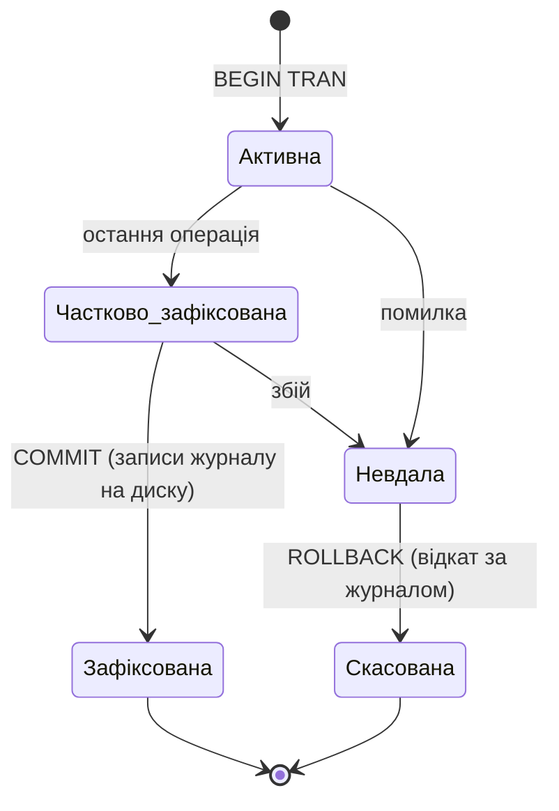
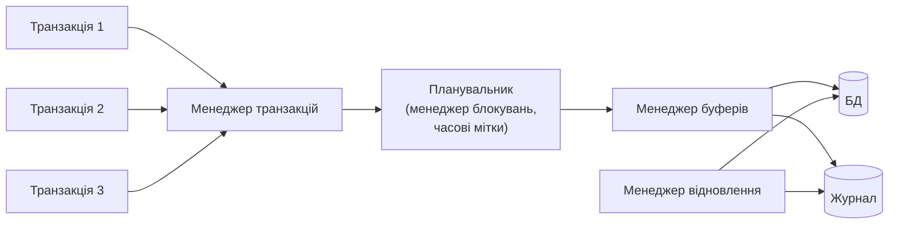

# Тема 8. Управління транзакціями

## 8.1. Поняття транзакції та її властивості

**Транзакція** — логічна одиниця роботи з базою даних: послідовність операцій, яка
виконується **повністю або не виконується зовсім** і переводить БД з одного узгодженого
стану в інший.

Класичний приклад — оплата навчання: треба **і** записати платіж, **і** зменшити борг
студента. Якщо збій станеться між цими діями, дані стануть суперечливими.

Властивості транзакцій — **ACID**:

| Властивість | Зміст | Хто забезпечує в SQL Server |
|-------------|-------|------------------------------|
| **A**tomicity — атомарність | або всі операції, або жодна | журнал транзакцій, `ROLLBACK` |
| **C**onsistency — узгодженість | транзакція переводить БД з узгодженого стану в узгоджений | обмеження цілісності, тригери, логіка застосування |
| **I**solation — ізольованість | паралельні транзакції не впливають одна на одну | блокування, версії рядків, рівні ізоляції |
| **D**urability — довговічність | результати зафіксованої транзакції не втрачаються навіть після збою | журнал з попереднім записом (WAL), резервні копії |

## 8.2. Порядок виконання операцій транзакції



У SQL Server транзакції бувають:

* **автоматичні** (autocommit, режим за замовчуванням) — кожен оператор є окремою транзакцією;
* **явні** — `BEGIN TRANSACTION … COMMIT / ROLLBACK`;
* **неявні** — після `SET IMPLICIT_TRANSACTIONS ON` транзакцію починає перший оператор,
  а завершувати її треба явно.

### Атомарність на практиці

```sql
USE UniversityDB;

SELECT StudentId, TuitionDebt FROM dbo.Student WHERE StudentId = 9;   -- борг 18000

BEGIN TRANSACTION;
    INSERT INTO dbo.Payment (StudentId, Amount) VALUES (9, 9000);
    UPDATE dbo.Student SET TuitionDebt = TuitionDebt - 9000 WHERE StudentId = 9;

    SELECT @@TRANCOUNT AS OpenTransactions;      -- 1: транзакція відкрита
    SELECT TuitionDebt FROM dbo.Student WHERE StudentId = 9;   -- 9000 (видно лише в цьому сеансі)
ROLLBACK TRANSACTION;                            -- відміняємо ОБИДВІ операції

SELECT TuitionDebt FROM dbo.Student WHERE StudentId = 9;       -- знову 18000
SELECT COUNT(*) AS Payments FROM dbo.Payment WHERE StudentId = 9;  -- 0: платежу немає
```

### Точки збереження та обробка помилок

```sql
BEGIN TRAN;
    UPDATE dbo.Teacher SET Salary = Salary * 1.05 WHERE Position = N'асистент';
    SAVE TRANSACTION AfterAssistants;            -- точка збереження

    UPDATE dbo.Teacher SET Salary = Salary * 1.50 WHERE Position = N'професор';
    ROLLBACK TRANSACTION AfterAssistants;        -- відкат лише до точки збереження
COMMIT;

SELECT LastName, Position, Salary FROM dbo.Teacher
WHERE Position IN (N'асистент', N'професор');    -- асистентам +5 %, професорам без змін
```

За замовчуванням помилка під час виконання **не** відкочує транзакцію автоматично:
оператор з помилкою скасовується, а наступні виконуються! Тому використовують
`TRY…CATCH` або `SET XACT_ABORT ON`:

```sql
-- Без захисту: помилка в другому операторі, але перший (і третій) зафіксуються
BEGIN TRAN;
    UPDATE dbo.Student SET City = N'Ірпінь' WHERE StudentId = 1;
    UPDATE dbo.Student SET Scholarship = -100 WHERE StudentId = 1;   -- порушення CHECK
COMMIT;
SELECT City, Scholarship FROM dbo.Student WHERE StudentId = 1;      -- City змінилося!
GO

-- Правильно: XACT_ABORT ON — будь-яка помилка відкочує всю транзакцію
SET XACT_ABORT ON;
BEGIN TRAN;
    UPDATE dbo.Student SET City = N'Київ' WHERE StudentId = 1;
    UPDATE dbo.Student SET Scholarship = -100 WHERE StudentId = 1;
COMMIT;
GO
SET XACT_ABORT OFF;
SELECT City FROM dbo.Student WHERE StudentId = 1;                   -- досі Ірпінь: відкочено все
GO

-- Правильно: TRY...CATCH
BEGIN TRY
    BEGIN TRAN;
        UPDATE dbo.Student SET City = N'Київ' WHERE StudentId = 1;
        UPDATE dbo.Student SET Scholarship = -100 WHERE StudentId = 1;
    COMMIT;
END TRY
BEGIN CATCH
    IF XACT_STATE() <> 0 ROLLBACK;
    SELECT ERROR_NUMBER() AS ErrNo, ERROR_MESSAGE() AS ErrMessage;
END CATCH;

UPDATE dbo.Student SET City = N'Київ' WHERE StudentId = 1;          -- повертаємо як було
```

## 8.3. Проблеми управління паралельним доступом

Коли кілька транзакцій одночасно працюють з тими самими даними, без керування
паралельністю виникають аномалії:

| Проблема | Опис |
|----------|------|
| **Втрачене оновлення** (lost update) | дві транзакції читають значення, змінюють і записують; результат першої затирається другою |
| **Брудне читання** (dirty read) | транзакція читає незафіксовані зміни іншої, яка потім відкочується |
| **Неповторюване читання** (non-repeatable read) | повторне читання рядка в межах транзакції дає інше значення, бо його змінила й зафіксувала інша транзакція |
| **Фантоми** (phantom read) | повторний запит повертає **нові рядки**, вставлені іншою транзакцією |
| **Несуперечливий аналіз** (inconsistent analysis) | підсумок обчислюється за даними, частина яких змінюється під час обчислення |

### Рівні ізоляції

Стандарт SQL визначає рівні ізоляції через те, які аномалії вони допускають:

| Рівень ізоляції | Брудне читання | Неповторюване читання | Фантоми | Механізм у SQL Server |
|-----------------|:-:|:-:|:-:|----------------------|
| `READ UNCOMMITTED` | можливе | можливе | можливі | читання без S-блокувань |
| `READ COMMITTED` (за замовчуванням) | — | можливе | можливі | S-блокування на час читання рядка |
| `REPEATABLE READ` | — | — | можливі | S-блокування до кінця транзакції |
| `SERIALIZABLE` | — | — | — | блокування діапазонів ключів |
| `SNAPSHOT` | — | — | — | версії рядків (tempdb), без блокувань читання |

Встановлюється так: `SET TRANSACTION ISOLATION LEVEL REPEATABLE READ;`

### Демонстрація аномалій у двох сеансах

!!! info "Як виконувати"
    Відкрийте **два вікна запитів** у SSMS (обидва з базою `UniversityDB`) і виконуйте
    кроки по черзі в порядку номерів, виділяючи потрібні рядки та натискаючи ++f5++.

#### Брудне читання

=== "Сеанс 1"

    ```sql
    -- Крок 1
    BEGIN TRAN;
    UPDATE dbo.Student SET Scholarship = 9999 WHERE StudentId = 1;   -- не фіксуємо!

    -- Крок 3
    ROLLBACK;
    ```

=== "Сеанс 2"

    ```sql
    -- Крок 2а: читаємо незафіксовані дані
    SET TRANSACTION ISOLATION LEVEL READ UNCOMMITTED;
    SELECT Scholarship FROM dbo.Student WHERE StudentId = 1;   -- 9999 — «брудні» дані!

    -- Крок 2б: на рівні READ COMMITTED запит ЧЕКАЄ, доки сеанс 1 не завершиться
    SET TRANSACTION ISOLATION LEVEL READ COMMITTED;
    SELECT Scholarship FROM dbo.Student WHERE StudentId = 1;   -- після кроку 3 поверне 2000
    ```

#### Неповторюване читання

=== "Сеанс 1"

    ```sql
    -- Крок 1
    SET TRANSACTION ISOLATION LEVEL READ COMMITTED;
    BEGIN TRAN;
    SELECT Salary FROM dbo.Teacher WHERE TeacherId = 4;   -- 19000

    -- Крок 3: те саме читання в тій самій транзакції
    SELECT Salary FROM dbo.Teacher WHERE TeacherId = 4;   -- 21000 — значення змінилося!
    COMMIT;

    -- Повторіть кроки з REPEATABLE READ: тоді крок 2 чекатиме на COMMIT сеансу 1
    ```

=== "Сеанс 2"

    ```sql
    -- Крок 2
    UPDATE dbo.Teacher SET Salary = Salary + 2000 WHERE TeacherId = 4;
    ```

#### Фантоми

=== "Сеанс 1"

    ```sql
    -- Крок 1
    SET TRANSACTION ISOLATION LEVEL REPEATABLE READ;
    BEGIN TRAN;
    SELECT COUNT(*) AS Cnt FROM dbo.Student WHERE GroupId = 5;   -- 0

    -- Крок 3
    SELECT COUNT(*) AS Cnt FROM dbo.Student WHERE GroupId = 5;   -- 1 — з'явився «фантом»
    COMMIT;

    -- З SERIALIZABLE вставка на кроці 2 чекатиме на COMMIT (блокування діапазону ключів)
    ```

=== "Сеанс 2"

    ```sql
    -- Крок 2
    INSERT INTO dbo.Student (GroupId, RecordBookNo, LastName, FirstName, BirthDate, Gender)
    VALUES (5, '24040099', N'Фантом', N'Петро', '2006-01-01', 'M');
    ```

#### Втрачене оновлення

Дві касирки одночасно вносять оплату за того самого студента, використовуючи шаблон
«прочитати → обчислити → записати»:

=== "Сеанс 1"

    ```sql
    -- Крок 1: застосування читає борг
    BEGIN TRAN;
    SELECT TuitionDebt FROM dbo.Student WHERE StudentId = 15;   -- 15000

    -- Крок 3: застосування обчислило 15000 − 5000 і записує результат
    UPDATE dbo.Student SET TuitionDebt = 10000 WHERE StudentId = 15;
    COMMIT;
    ```

=== "Сеанс 2"

    ```sql
    -- Крок 2: інше застосування читає той самий борг
    BEGIN TRAN;
    SELECT TuitionDebt FROM dbo.Student WHERE StudentId = 15;   -- теж 15000

    -- Крок 4: обчислило 15000 − 3000 і записує результат
    UPDATE dbo.Student SET TuitionDebt = 12000 WHERE StudentId = 15;
    COMMIT;
    -- Разом сплачено 8000, а борг 12000 замість 7000: оплата сеансу 1 втрачена!
    ```

Як уникнути: змінювати значення **одним оператором** (`SET TuitionDebt = TuitionDebt - 5000`)
або читати з підказкою `WITH (UPDLOCK)`: тоді крок 2 чекатиме, доки сеанс 1 не зафіксує
зміни, і прочитає вже 10000:

```sql
BEGIN TRAN;
    DECLARE @debt DECIMAL(10,2) =
        (SELECT TuitionDebt FROM dbo.Student WITH (UPDLOCK) WHERE StudentId = 15);
    UPDATE dbo.Student SET TuitionDebt = @debt - 5000 WHERE StudentId = 15;
COMMIT;
```

## 8.4. Впорядкування та відновлення транзакцій

**Розклад** (графік) — послідовність, у якій виконуються операції кількох транзакцій.

* **Послідовний** розклад — транзакції виконуються одна за одною без чергування. Завжди
  коректний, але повільний.
* **Серіалізовний** розклад — паралельний розклад, результат якого **еквівалентний
  деякому послідовному**. Мета керування паралельністю — допускати лише серіалізовні розклади.

Дві операції різних транзакцій **конфліктують**, якщо вони звертаються до одного елемента
даних і хоча б одна з них — запис. Розклад **серіалізовний за конфліктами**, якщо
**граф передування** (вершини — транзакції, дуга T<sub>i</sub> → T<sub>j</sub>, якщо
операція T<sub>i</sub> конфліктує з пізнішою операцією T<sub>j</sub>) **не має циклів**.

Приклад розкладу «втраченого оновлення» вище:

| Час | T1 | T2 |
|----:|----|----|
| 1 | read(debt) | |
| 2 | | read(debt) |
| 3 | write(debt) | |
| 4 | | write(debt) |

Дуги: T1 → T2 (read(1) — write(4)), T2 → T1 (read(2) — write(3)) — **цикл**, розклад не
серіалізовний.

**Відновлюваний розклад** — транзакція фіксується лише після фіксації всіх транзакцій, чиї
дані вона читала. Інакше можливі **каскадні відкати**.

## 8.5. Методи управління паралельним доступом

### Методи блокувань

**Блокування** (lock) — позначка, що надає транзакції право доступу до елемента даних і
обмежує доступ інших. Основні режими:

| Режим | Призначення | Сумісний з S | Сумісний з X |
|-------|-------------|:-:|:-:|
| **S** (shared, спільне) | читання | ✔ | ✘ |
| **X** (exclusive, монопольне) | запис | ✘ | ✘ |
| **U** (update) | читання з наміром змінити (запобігає взаємоблокуванням) | ✔ | ✘ |
| **IS, IX** (intent) | на рівні таблиці/сторінки: «нижче є S/X-блокування» | | |

**Гранулярність** блокувань: рядок (`RID`/`KEY`) → сторінка (`PAGE`) → таблиця (`OBJECT`) → БД.
Дрібні блокування — більше паралельності, але більше накладних витрат; SQL Server при
великій кількості блокувань виконує **ескалацію** до рівня таблиці.

**Двофазний протокол блокування (2PL)**: кожна транзакція має **фазу зростання** (лише
захоплює блокування) і **фазу скорочення** (лише звільняє). 2PL гарантує
серіалізовність. **Строгий 2PL** утримує X-блокування до фіксації — так працює SQL Server
(X-блокування звільняються тільки при `COMMIT`/`ROLLBACK`).

Подивимося, які блокування утримує власна транзакція:

```sql
SET TRANSACTION ISOLATION LEVEL REPEATABLE READ;
BEGIN TRAN;
    SELECT LastName FROM dbo.Student WHERE StudentId = 2;              -- S на ключ (до кінця транзакції)
    UPDATE dbo.Student SET City = N'Львів' WHERE StudentId = 2;        -- X на ключ

    SELECT resource_type, request_mode, request_status, resource_description
    FROM sys.dm_tran_locks
    WHERE request_session_id = @@SPID
      AND resource_database_id = DB_ID()
      AND resource_type <> 'DATABASE';
ROLLBACK;
SET TRANSACTION ISOLATION LEVEL READ COMMITTED;
```

??? example "Результат (приблизно)"
    | resource_type | request_mode | request_status | resource_description |
    |---------------|--------------|----------------|----------------------|
    | OBJECT | IX | GRANT | |
    | PAGE | IX | GRANT | 1:… |
    | KEY | X | GRANT | (…) |

    Блокування S на рядок «перетворилося» на X; на сторінку і таблицю накладено
    блокування намірів IX.

Хто кого блокує зараз (корисно, коли «зависає» запит):

```sql
SELECT r.session_id, r.blocking_session_id, r.wait_type, r.wait_time, t.text AS SqlText
FROM sys.dm_exec_requests AS r
CROSS APPLY sys.dm_exec_sql_text(r.sql_handle) AS t
WHERE r.blocking_session_id <> 0;
```

### Методи обробки взаємоблокувань

**Взаємоблокування** (deadlock) — ситуація, коли дві чи більше транзакцій чекають одна на
одну по колу. Методи:

* **запобігання** — упорядкування ресурсів (усі транзакції захоплюють блокування в одному
  порядку); схеми з часовими мітками **«чекати — померти»** (wait-die: старша чекає,
  молодша відкочується) і **«поранити — чекати»** (wound-wait: старша відкочує молодшу,
  молодша чекає);
* **виявлення** — побудова **графа очікувань** і пошук циклу; одна з транзакцій-«жертв»
  відкочується. Так діє SQL Server: монітор взаємоблокувань перевіряє граф кожні 5 секунд
  і повертає жертві помилку **1205**;
* **тайм-аути** — транзакція, що чекає довше за ліміт, відкочується
  (`SET LOCK_TIMEOUT 5000`).

=== "Сеанс 1"

    ```sql
    -- Крок 1
    BEGIN TRAN;
    UPDATE dbo.Student SET City = N'Київ' WHERE StudentId = 1;      -- X на студента 1

    -- Крок 3: чекаємо на студента 2 (його заблокував сеанс 2)
    UPDATE dbo.Student SET City = N'Київ' WHERE StudentId = 2;
    COMMIT;
    ```

=== "Сеанс 2"

    ```sql
    -- Крок 2
    BEGIN TRAN;
    UPDATE dbo.Student SET City = N'Львів' WHERE StudentId = 2;     -- X на студента 2

    -- Крок 4: чекаємо на студента 1 → цикл очікування!
    UPDATE dbo.Student SET City = N'Львів' WHERE StudentId = 1;
    COMMIT;
    -- Через кілька секунд один із сеансів отримає:
    -- Msg 1205: Transaction (Process ID ...) was deadlocked on lock resources with another
    -- process and has been chosen as the deadlock victim. Rerun the transaction.
    ```

Застосування має перехоплювати помилку 1205 і **повторювати** транзакцію:

```sql
DECLARE @retry INT = 3;
WHILE @retry > 0
BEGIN
    BEGIN TRY
        BEGIN TRAN;
            UPDATE dbo.Student SET City = N'Київ' WHERE StudentId = 1;
            UPDATE dbo.Student SET City = N'Львів' WHERE StudentId = 2;
        COMMIT;
        SET @retry = 0;                               -- успіх
    END TRY
    BEGIN CATCH
        IF XACT_STATE() <> 0 ROLLBACK;
        IF ERROR_NUMBER() = 1205 AND @retry > 1
        BEGIN
            SET @retry -= 1;
            WAITFOR DELAY '00:00:00.200';             -- коротка пауза і повтор
        END
        ELSE
            THROW;
    END CATCH;
END;
```

### Методи з використанням часових відміток

Кожна транзакція T отримує **часову мітку** TS(T) — момент старту. Для кожного елемента
даних X зберігаються `read_TS(X)` і `write_TS(X)` — мітки наймолодших транзакцій, що його
читали/записували. Конфлікти розв'язуються **без блокувань**:

* T хоче **читати** X, але `TS(T) < write_TS(X)` (X уже переписала молодша транзакція) →
  T відкочується і перезапускається з новою міткою;
* T хоче **записати** X, але `TS(T) < read_TS(X)` або `TS(T) < write_TS(X)` → T відкочується;
* **правило Томаса**: якщо `TS(T) < write_TS(X)`, застарілий запис можна просто проігнорувати.

У SQL Server ідею часових міток реалізують **версії рядків**: тип `rowversion` —
лічильник, що автоматично змінюється при кожній зміні рядка, а рівень `SNAPSHOT` —
**багатоверсійне** керування (MVCC): кожна транзакція бачить знімок даних на момент свого
початку.

### Оптимістичні методи впорядкування транзакцій

**Песимістичні** методи (блокування) вважають, що конфлікти часті, і запобігають їм
заздалегідь. **Оптимістичні** — що конфлікти рідкісні: транзакція працює без блокувань,
а перевірка відбувається наприкінці. Три фази:

1. **читання** — транзакція читає дані й робить зміни в локальній копії;
2. **перевірка (валідація)** — чи не змінила хтось прочитані дані;
3. **запис** — якщо перевірка успішна, зміни записуються в БД, інакше транзакція
   відкочується і перезапускається.

Оптимістичне керування з `rowversion` (типове для веб-застосувань: користувач відкрив
форму, редагує кілька хвилин, а блокувати рядок увесь цей час не можна):

```sql
ALTER TABLE dbo.Course ADD RowVer ROWVERSION;
GO

-- 1. Фаза читання: застосування зберігає версію рядка разом з даними
DECLARE @ver BINARY(8), @credits DECIMAL(3,1);
SELECT @credits = Credits, @ver = RowVer FROM dbo.Course WHERE Code = 'DB101';

-- (тим часом інший користувач змінює цей рядок)
UPDATE dbo.Course SET Credits = 5.5 WHERE Code = 'DB101';

-- 2-3. Валідація і запис: оновлюємо, лише якщо версія не змінилася
UPDATE dbo.Course SET Credits = @credits + 1
WHERE Code = 'DB101' AND RowVer = @ver;

IF @@ROWCOUNT = 0
    PRINT N'Конфлікт: дані змінив інший користувач. Перечитайте їх і повторіть.';
GO

ALTER TABLE dbo.Course DROP COLUMN RowVer;
UPDATE dbo.Course SET Credits = 6.0 WHERE Code = 'DB101';
```

Рівень **SNAPSHOT** — оптимістичне керування, вбудоване в СКБД (у `UniversityDB` воно
дозволене параметром `ALLOW_SNAPSHOT_ISOLATION ON`):

=== "Сеанс 1"

    ```sql
    -- Крок 1
    SET TRANSACTION ISOLATION LEVEL SNAPSHOT;
    BEGIN TRAN;
    SELECT Salary FROM dbo.Teacher WHERE TeacherId = 7;   -- 25000

    -- Крок 3: бачимо ЗНІМОК на момент початку транзакції, читання не блокується
    SELECT Salary FROM dbo.Teacher WHERE TeacherId = 7;   -- досі 25000

    -- Крок 4: спроба змінити рядок, який змінили після початку транзакції
    UPDATE dbo.Teacher SET Salary = Salary + 500 WHERE TeacherId = 7;
    -- Msg 3960: Snapshot isolation transaction aborted due to update conflict...
    ```

=== "Сеанс 2"

    ```sql
    -- Крок 2
    UPDATE dbo.Teacher SET Salary = 26000 WHERE TeacherId = 7;   -- не чекає!
    ```

### Управління паралельним виконанням транзакцій з використанням планувальника

**Планувальник** (scheduler) — компонент СКБД, що отримує операції від транзакцій і
визначає порядок їх виконання так, щоб розклад був серіалізовним. Для кожної операції
планувальник може:

* **виконати** її негайно;
* **відкласти** (поставити в чергу, наприклад, до звільнення блокування);
* **відхилити** — відкотити транзакцію (при взаємоблокуванні, конфлікті міток).



## 8.6. Механізми відновлення бази даних

### Функції СКБД з відновлення

Типи збоїв: **збій транзакції** (помилка, відкат, взаємоблокування), **збій системи**
(вимкнення живлення, падіння сервера — вміст оперативної пам'яті втрачено), **збій
носія** (пошкоджено диск). СКБД має забезпечити:

* **відкат** (UNDO) незафіксованих транзакцій;
* **повторення** (REDO) зафіксованих транзакцій, зміни яких не встигли потрапити на диск;
* відновлення з **резервних копій** після збою носія.

### Журнал транзакцій

**Журнал** — послідовний файл, куди записуються всі зміни: ідентифікатор транзакції, тип
операції, ідентифікатор об'єкта, **образ «до»** (для UNDO) та **образ «після»** (для REDO),
позначки початку і фіксації транзакцій. Правило **WAL** (write-ahead logging): запис
журналу потрапляє на диск **раніше**, ніж змінена сторінка даних; транзакція вважається
зафіксованою, коли її запис `COMMIT` записано в журнал.

```sql
-- Скільки місця займає журнал і яка модель відновлення
SELECT name, recovery_model_desc, log_reuse_wait_desc FROM sys.databases WHERE name = DB_NAME();
SELECT total_log_size_in_bytes / 1024 AS LogKB, used_log_space_in_percent FROM sys.dm_db_log_space_usage;

-- Записи журналу для нашої транзакції (недокументована функція, лише для навчання)
CHECKPOINT;
BEGIN TRAN DemoLog;
    UPDATE dbo.Student SET City = N'Бровари' WHERE StudentId = 8;
COMMIT;

SELECT [Current LSN], Operation, Context, [Transaction Name], AllocUnitName
FROM sys.fn_dblog(NULL, NULL)
WHERE [Transaction ID] IN (SELECT [Transaction ID] FROM sys.fn_dblog(NULL, NULL)
                           WHERE [Transaction Name] = 'DemoLog');

UPDATE dbo.Student SET City = N'Київ' WHERE StudentId = 8;
```

??? example "Результат (приблизно)"
    | Current LSN | Operation | Context | Transaction Name | AllocUnitName |
    |-------------|-----------|---------|------------------|---------------|
    | 00000025:… | LOP_BEGIN_XACT | LCX_NULL | DemoLog | |
    | 00000025:… | LOP_MODIFY_COLUMNS | LCX_CLUSTERED | | dbo.Student.PK_Student |
    | 00000025:… | LOP_COMMIT_XACT | LCX_NULL | | |

    Запис зміни (`LOP_MODIFY_ROW` або `LOP_MODIFY_COLUMNS`) містить образи даних «до» і «після».

### Створення контрольних точок

**Контрольна точка** (checkpoint) — момент, коли всі змінені («брудні») сторінки з
буфера записуються на диск, а в журнал додається позначка зі списком активних транзакцій.
Під час відновлення журнал аналізується лише **від останньої контрольної точки**:

* транзакції, зафіксовані **до** контрольної точки, — нічого робити не треба;
* зафіксовані **після** — REDO;
* не зафіксовані на момент збою — UNDO.

```text
           Контрольна точка (КТ)                         Збій
                    │                                      │
T1  ════════════╡   │                                      │   зафіксована до КТ → нічого не робимо
T2         ═════════╪══════════════╡                       │   зафіксована після КТ → REDO
T3                  │         ═════════════════════════════╪   не завершена → UNDO
T4  ═════════════════════════════════════╡                 │   почалася до КТ, зафіксована після → REDO
                    │                                      │
────────────────────┴──────────────────────────────────────┴──────► час
                    ╡ — COMMIT
```

SQL Server виконує контрольні точки автоматично; вручну — командою `CHECKPOINT`.

### Метод відкладеного оновлення

Зміни транзакції записуються **лише в журнал**; у БД вони потрапляють **після фіксації**.
Під час відновлення: для зафіксованих транзакцій — **REDO**, для незафіксованих — нічого
(у БД їх змін немає). UNDO не потрібен.

### Метод негайного оновлення

Зміни записуються в БД **одразу** (після запису в журнал за правилом WAL), ще до фіксації.
Під час відновлення: зафіксовані — **REDO**, незафіксовані — **UNDO** за образами «до».
Цей метод (алгоритм ARIES) використовує SQL Server.

### Метод тіньового сторінкового обміну

БД розглядається як набір сторінок, доступних через **таблицю сторінок**. Транзакція має
дві таблиці: **поточну** і **тіньову**. При зміні сторінки її нова версія пишеться в
**нове** місце, і поточна таблиця вказує на нову копію; тіньова — на стару. Фіксація —
атомарна заміна тіньової таблиці поточною; відкат — просто відкинути поточну таблицю.
Журнал не потрібен, але дані фрагментуються, а збирання сміття ускладнюється.
(Схожий принцип «копіювання при записі» використовують SQLite у режимі WAL, LMDB, файлові
системи ZFS і Btrfs.)

### Резервне копіювання та відновлення в SQL Server

**Модель відновлення** визначає, що зберігається в журналі:
`SIMPLE` (журнал усікається на контрольних точках), `FULL` (зберігається все до
резервного копіювання журналу — можна відновити на будь-який момент часу),
`BULK_LOGGED`.

```sql
USE master;
ALTER DATABASE UniversityDB SET RECOVERY FULL;

DECLARE @dir NVARCHAR(400) = CAST(SERVERPROPERTY('InstanceDefaultBackupPath') AS NVARCHAR(400));
DECLARE @full NVARCHAR(400) = @dir + N'/UniversityDB_full.bak',
        @log  NVARCHAR(400) = @dir + N'/UniversityDB_log.trn';

-- Повна резервна копія
BACKUP DATABASE UniversityDB TO DISK = @full WITH INIT, NAME = N'Full backup';

-- «Випадкове» видалення даних
DELETE FROM UniversityDB.dbo.Payment;

-- Резервна копія журналу (містить і помилкове видалення)
BACKUP LOG UniversityDB TO DISK = @log WITH INIT;

-- Відновлення: повна копія + журнал до моменту ПЕРЕД видаленням
-- (тут для простоти відновлюємо лише повну копію)
ALTER DATABASE UniversityDB SET SINGLE_USER WITH ROLLBACK IMMEDIATE;
RESTORE DATABASE UniversityDB FROM DISK = @full WITH REPLACE, RECOVERY;
ALTER DATABASE UniversityDB SET MULTI_USER;

SELECT COUNT(*) AS PaymentsRestored FROM UniversityDB.dbo.Payment;   -- 8: дані повернулися
```

Для відновлення на момент часу використовують
`RESTORE LOG ... WITH STOPAT = '2025-06-01T12:00:00'`.

## 8.7. Управління транзакціями за допомогою мови SQL

| Оператор | Призначення |
|----------|-------------|
| `BEGIN TRAN[SACTION] [ім'я]` | почати явну транзакцію |
| `COMMIT [TRAN]` | зафіксувати |
| `ROLLBACK [TRAN] [точка]` | відкотити повністю або до точки збереження |
| `SAVE TRAN[SACTION] точка` | створити точку збереження |
| `SET TRANSACTION ISOLATION LEVEL ...` | рівень ізоляції сеансу |
| `SET XACT_ABORT ON` | автоматичний відкат при будь-якій помилці |
| `SET IMPLICIT_TRANSACTIONS ON` | режим неявних транзакцій |
| `SET LOCK_TIMEOUT мс` | максимальний час очікування блокування |
| `@@TRANCOUNT`, `XACT_STATE()` | кількість відкритих транзакцій, стан транзакції |
| Табличні підказки `WITH (UPDLOCK / HOLDLOCK / NOLOCK / READPAST)` | керування блокуваннями для окремої таблиці в запиті |

**Вкладені транзакції** в SQL Server — лише лічильник: внутрішній `COMMIT` тільки
зменшує `@@TRANCOUNT`, а `ROLLBACK` будь-де відкочує **все**:

```sql
BEGIN TRAN;                                   -- @@TRANCOUNT = 1
    UPDATE dbo.Student SET City = N'Одеса' WHERE StudentId = 11;
    BEGIN TRAN;                               -- @@TRANCOUNT = 2
        UPDATE dbo.Student SET City = N'Ізмаїл' WHERE StudentId = 11;
    COMMIT;                                   -- @@TRANCOUNT = 1, нічого не зафіксовано!
    SELECT @@TRANCOUNT AS TranCount;
ROLLBACK;                                     -- відкочує обидві зміни

SELECT City FROM dbo.Student WHERE StudentId = 11;   -- Одеса (як було)
```

## Контрольні питання

1. Що таке транзакція? Поясніть властивості ACID на прикладі оплати навчання.
2. Які стани проходить транзакція?
3. Опишіть аномалії паралельного доступу. Які рівні ізоляції їх усувають?
4. Що таке серіалізовний розклад? Як перевірити серіалізовність за графом передування?
5. Що таке двофазний протокол блокування? Чим строгий 2PL відрізняється від звичайного?
6. Як SQL Server виявляє взаємоблокування? Як застосування має реагувати на помилку 1205?
7. Як працюють методи впорядкування за часовими мітками? Що таке правило Томаса?
8. Чим оптимістичні методи відрізняються від песимістичних? Наведіть приклад з `rowversion`.
9. Яку інформацію містить журнал транзакцій? Що таке правило WAL?
10. Порівняйте методи відкладеного та негайного оновлення і тіньового сторінкового обміну.
11. Навіщо потрібні контрольні точки?
