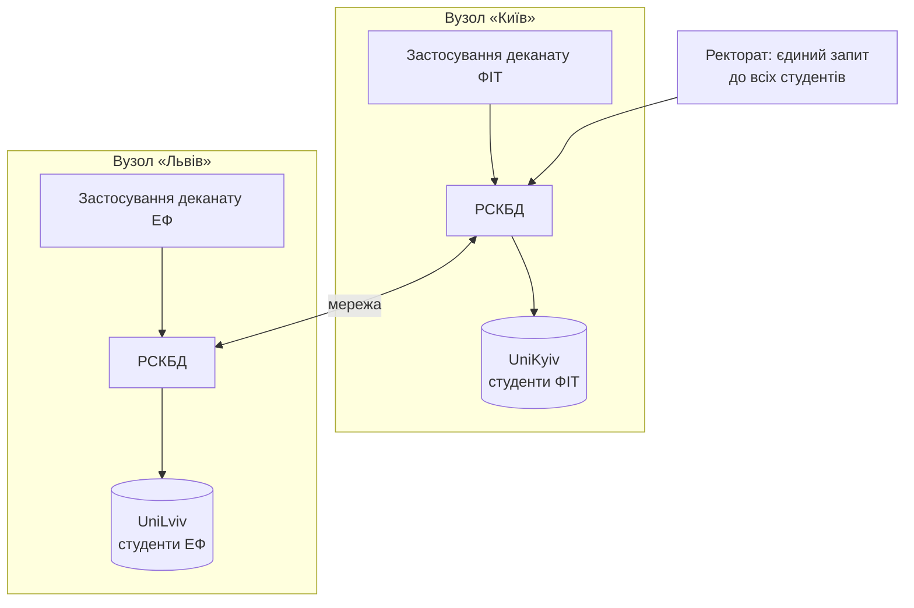
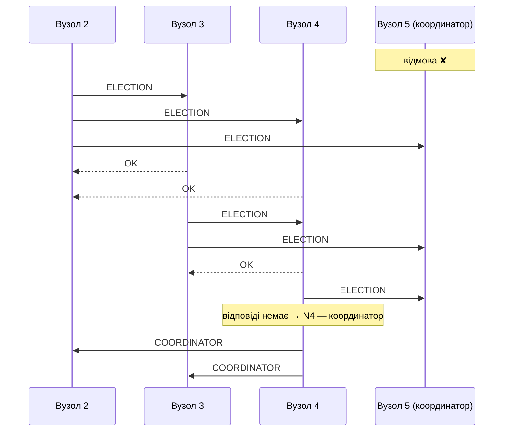

# Тема 9. Розподілені бази даних

## 9.1. Концепція розподілених баз даних. Основні поняття

**Розподілена база даних (РБД)** — сукупність логічно пов'язаних баз даних, фізично
розміщених на різних вузлах комп'ютерної мережі.

**Розподілена СКБД (РСКБД)** — програмна система, що керує РБД і робить розподіл
**прозорим** для користувачів: користувач працює з РБД так, ніби вона централізована.

Приклад: університет має кампуси в **Києві** (ФІТ) і **Львові** (ЕФ). Дані про студентів
зберігаються там, де вони переважно використовуються, але ректорат бачить єдину базу.



Розрізняють:

* **однорідні** РБД — на всіх вузлах однакова СКБД (наприклад, лише SQL Server);
* **неоднорідні** (гетерогенні) — різні СКБД (SQL Server + PostgreSQL + Oracle), що
  взаємодіють через шлюзи;
* **мультибази даних (федеративні)** — автономні БД, об'єднані спільним рівнем доступу.

### 12 правил К. Дейта для розподілених СУБД

1. Локальна автономія вузлів.
2. Відсутність опори на центральний вузол.
3. Безперервне функціонування (без планових зупинок).
4. Незалежність від розташування (прозорість розміщення).
5. Незалежність від фрагментації.
6. Незалежність від реплікації.
7. Обробка розподілених запитів.
8. Керування розподіленими транзакціями.
9. Незалежність від апаратного забезпечення.
10. Незалежність від операційної системи.
11. Незалежність від мережі.
12. Незалежність від СКБД.

### Рівні прозорості

| Прозорість | Користувач не мусить знати… |
|------------|------------------------------|
| **фрагментації** | що таблицю розбито на частини |
| **розміщення** | на якому вузлі лежить фрагмент |
| **реплікації** | що існує кілька копій даних |
| **локального відображення** | які імена та структури має фрагмент на конкретному вузлі |
| **транзакцій** | що транзакція зачіпає кілька вузлів |

## 9.2. Принципи створення розподілених баз даних

**Переваги:** відповідність розподіленій структурі організації; вища доступність
(відмова одного вузла не зупиняє всю систему); локальна обробка даних — швидше та
дешевше; масштабованість.

**Недоліки:** складність проектування та адміністрування; складніше забезпечити
цілісність і безпеку; витрати на мережевий обмін; складні механізми розподілених
транзакцій і відновлення.

## 9.3. Проектування розподіленої бази даних

Етапи:

1. Побудова **глобальної концептуальної схеми** (як для централізованої БД).
2. **Фрагментація** відношень.
3. **Розміщення** фрагментів по вузлах (з реплікацією чи без).
4. Проектування **локальних схем** на кожному вузлі.

Підходи: **низхідний** (від глобальної схеми до фрагментів — для нових систем) і
**висхідний** (інтеграція вже наявних БД у федеративну систему).

### Підготовка прикладів

Змоделюємо два вузли окремими базами даних на одному сервері: `UniKyiv` і `UniLviv`.
На реальній системі це були б окремі сервери, з'єднані **зв'язаними серверами**
(linked servers) — див. [9.6](#розподілені-запити-та-прозорість-розміщення).

```sql
USE master;
IF DB_ID(N'UniKyiv') IS NOT NULL DROP DATABASE UniKyiv;
IF DB_ID(N'UniLviv') IS NOT NULL DROP DATABASE UniLviv;
CREATE DATABASE UniKyiv COLLATE Cyrillic_General_CI_AS;
CREATE DATABASE UniLviv COLLATE Cyrillic_General_CI_AS;
```

## 9.4. Фрагментація даних у розподіленій базі даних

**Фрагментація** — розбиття відношення на частини (фрагменти), що зберігаються на різних
вузлах. Вимоги до коректної фрагментації:

* **повнота** — кожен кортеж (атрибут) вихідного відношення потрапляє хоча б в один фрагмент;
* **відновлюваність** — вихідне відношення можна відновити з фрагментів операціями
  реляційної алгебри (`UNION` для горизонтальної, `JOIN` для вертикальної);
* **неперетинність** — кортеж (неключовий атрибут) потрапляє лише в один фрагмент.

### Горизонтальна фрагментація

Відношення розбивається на підмножини **рядків** за умовою селекції (σ). Студентів
розподілимо за факультетом. Факультет — атрибут не самої таблиці `Student`, а групи →
кафедри → факультету, тому це **похідна** горизонтальна фрагментація (за умовою на
пов'язаному відношенні).

```sql
-- Фрагмент 1 на вузлі «Київ»: σ Faculty = ФІТ (Student)
SELECT s.StudentId, s.RecordBookNo, s.LastName, s.FirstName, s.GroupId, d.FacultyId,
       s.City, s.IsContract, s.Scholarship, s.TuitionDebt
INTO UniKyiv.dbo.Student_FIT
FROM UniversityDB.dbo.Student AS s
JOIN UniversityDB.dbo.StudentGroup AS g ON g.GroupId      = s.GroupId
JOIN UniversityDB.dbo.Department   AS d ON d.DepartmentId = g.DepartmentId
WHERE d.FacultyId = 1;

-- Фрагмент 2 на вузлі «Львів»: σ Faculty = ЕФ (Student)
SELECT s.StudentId, s.RecordBookNo, s.LastName, s.FirstName, s.GroupId, d.FacultyId,
       s.City, s.IsContract, s.Scholarship, s.TuitionDebt
INTO UniLviv.dbo.Student_EF
FROM UniversityDB.dbo.Student AS s
JOIN UniversityDB.dbo.StudentGroup AS g ON g.GroupId      = s.GroupId
JOIN UniversityDB.dbo.Department   AS d ON d.DepartmentId = g.DepartmentId
WHERE d.FacultyId = 2;

-- Первинні ключі та CHECK-обмеження, що описують умову фрагментації
ALTER TABLE UniKyiv.dbo.Student_FIT ADD CONSTRAINT PK_Student_FIT PRIMARY KEY (StudentId, FacultyId);
ALTER TABLE UniKyiv.dbo.Student_FIT ADD CONSTRAINT CK_Student_FIT CHECK (FacultyId = 1);
ALTER TABLE UniLviv.dbo.Student_EF  ADD CONSTRAINT PK_Student_EF  PRIMARY KEY (StudentId, FacultyId);
ALTER TABLE UniLviv.dbo.Student_EF  ADD CONSTRAINT CK_Student_EF  CHECK (FacultyId = 2);
```

Глобальне відношення відновлюється об'єднанням фрагментів. Створимо **розподілене
секціоноване представлення** — воно забезпечує прозорість фрагментації:

```sql
USE UniversityDB;
GO
CREATE OR ALTER VIEW dbo.vStudentGlobal
AS
SELECT * FROM UniKyiv.dbo.Student_FIT
UNION ALL
SELECT * FROM UniLviv.dbo.Student_EF;
GO

-- Користувач пише звичайний запит, не знаючи про фрагменти
SELECT FacultyId, COUNT(*) AS Students FROM dbo.vStudentGlobal GROUP BY FacultyId;

-- Завдяки CHECK-обмеженням оптимізатор звертається лише до потрібного фрагмента
SET STATISTICS IO ON;
SELECT LastName FROM dbo.vStudentGlobal WHERE FacultyId = 2;   -- читає лише Student_EF
SET STATISTICS IO OFF;
```

Перевірка коректності фрагментації:

```sql
-- Повнота і відновлюваність: (усі студенти) EXCEPT (об'єднання фрагментів) = ∅
SELECT StudentId FROM UniversityDB.dbo.Student
EXCEPT
SELECT StudentId FROM UniversityDB.dbo.vStudentGlobal;

-- Неперетинність: фрагменти не мають спільних рядків
SELECT StudentId FROM UniKyiv.dbo.Student_FIT
INTERSECT
SELECT StudentId FROM UniLviv.dbo.Student_EF;
```

Обидва запити повертають порожній результат — фрагментація коректна.

### Вертикальна фрагментація

Відношення розбивається на підмножини **атрибутів** (проекції π); **первинний ключ
входить у кожен фрагмент**, щоб відношення можна було відновити з'єднанням. Наприклад,
навчальні дані студента потрібні деканату (Київ), а фінансові — бухгалтерії (Львів):

```sql
-- π StudentId, LastName, FirstName, GroupId, City (Student) — вузол «Київ»
SELECT StudentId, LastName, FirstName, GroupId, City
INTO UniKyiv.dbo.Student_Study
FROM UniversityDB.dbo.Student;

-- π StudentId, IsContract, Scholarship, TuitionDebt (Student) — вузол «Львів»
SELECT StudentId, IsContract, Scholarship, TuitionDebt
INTO UniLviv.dbo.Student_Finance
FROM UniversityDB.dbo.Student;

-- Відновлення: з'єднання за первинним ключем
SELECT st.StudentId, st.LastName, st.City, f.Scholarship, f.TuitionDebt
FROM UniKyiv.dbo.Student_Study   AS st
JOIN UniLviv.dbo.Student_Finance AS f ON f.StudentId = st.StudentId
WHERE f.TuitionDebt > 0;
```

### Змішана фрагментація

Поєднання обох видів: спочатку горизонтальна, потім вертикальна (або навпаки).
Наприклад, фінансові атрибути лише студентів-контрактників:
π<sub>StudentId, TuitionDebt</sub>(σ<sub>IsContract = 1</sub>(Student)).

## 9.5. Реплікація даних у розподіленій базі даних

**Реплікація** — зберігання **копій** (реплік) одних і тих самих даних на кількох вузлах.

| Переваги | Недоліки |
|----------|----------|
| швидке локальне читання | треба підтримувати узгодженість копій |
| висока доступність: при відмові вузла дані є на іншому | оновлення дорожчі (зміни на всіх копіях) |
| розподіл навантаження | більше місця для зберігання |

Види реплікації:

* **синхронна (активна)** — зміна застосовується до всіх копій у межах однієї
  транзакції (через 2PC); копії завжди узгоджені, але оновлення повільні й залежать від
  доступності всіх вузлів;
* **асинхронна (відкладена, лінива)** — зміна спершу фіксується на одному вузлі, а
  розсилається пізніше; копії тимчасово можуть розходитися (*узгодженість у кінцевому
  підсумку*, eventual consistency).

За місцем внесення змін: **з основною копією** (master–slave: змінювати можна лише
головну копію) і **з рівноправними копіями** (multi-master: змінювати можна будь-яку,
потрібне розв'язання конфліктів).

### Реплікація в SQL Server

| Механізм | Опис |
|----------|------|
| **Snapshot replication** | періодичне копіювання повного знімка даних |
| **Transactional replication** | асинхронна передача змін з журналу транзакцій видавця передплатникам (основна копія) |
| **Merge replication** | зміни на всіх вузлах з подальшим злиттям і розв'язанням конфліктів (рівноправні копії) |
| **Peer-to-peer** | транзакційна реплікація між рівноправними вузлами |
| **Always On Availability Groups** | синхронні або асинхронні вторинні репліки всієї БД; вторинні репліки можна використовувати для читання |

Термінологія реплікації SQL Server: **видавець** (publisher) — джерело даних,
**дистриб'ютор** (distributor) — посередник, **передплатник** (subscriber) — отримувач,
**публікація** — набір **статей** (таблиць), що реплікуються.

### Модель асинхронної реплікації з основною копією

Справжня реплікація налаштовується майстром у SSMS і потребує агента SQL Server. Ідею
легко змоделювати засобами **відстеження змін** (Change Tracking): основна копія
дисциплін — у `UniversityDB`, репліка — на вузлі «Львів».

```sql
-- 1. Вмикаємо відстеження змін на основній копії
ALTER DATABASE UniversityDB SET CHANGE_TRACKING = ON (CHANGE_RETENTION = 2 DAYS, AUTO_CLEANUP = ON);
ALTER TABLE UniversityDB.dbo.Course ENABLE CHANGE_TRACKING;

-- 2. Початковий знімок (snapshot) на репліку + версія, до якої репліка синхронізована
-- На репліці CourseId без IDENTITY: ключі приходять з основної копії
CREATE TABLE UniLviv.dbo.Course_Replica (
    CourseId INT PRIMARY KEY,
    Code     VARCHAR(10)   NOT NULL,
    Title    NVARCHAR(100) NOT NULL,
    Credits  DECIMAL(3,1)  NOT NULL
);
INSERT INTO UniLviv.dbo.Course_Replica (CourseId, Code, Title, Credits)
SELECT CourseId, Code, Title, Credits FROM UniversityDB.dbo.Course;

CREATE TABLE UniLviv.dbo.SyncState (TableName SYSNAME PRIMARY KEY, LastVersion BIGINT NOT NULL);
INSERT INTO UniLviv.dbo.SyncState VALUES (N'Course', CHANGE_TRACKING_CURRENT_VERSION());
```

```sql
-- 3. Процедура синхронізації: застосовує до репліки зміни з моменту останньої синхронізації
USE UniversityDB;
GO
CREATE OR ALTER PROCEDURE dbo.usp_SyncCourseReplica
AS
BEGIN
    SET NOCOUNT ON;
    DECLARE @from BIGINT = (SELECT LastVersion FROM UniLviv.dbo.SyncState WHERE TableName = N'Course'),
            @to   BIGINT = CHANGE_TRACKING_CURRENT_VERSION();

    MERGE UniLviv.dbo.Course_Replica AS r
    USING (SELECT ct.CourseId, ct.SYS_CHANGE_OPERATION AS Op, c.Code, c.Title, c.Credits
           FROM CHANGETABLE(CHANGES dbo.Course, @from) AS ct
           LEFT JOIN dbo.Course AS c ON c.CourseId = ct.CourseId) AS chg
       ON r.CourseId = chg.CourseId
    WHEN MATCHED AND chg.Op = 'D' THEN DELETE
    WHEN MATCHED THEN UPDATE SET Code = chg.Code, Title = chg.Title, Credits = chg.Credits
    WHEN NOT MATCHED BY TARGET AND chg.Op <> 'D' THEN
        INSERT (CourseId, Code, Title, Credits) VALUES (chg.CourseId, chg.Code, chg.Title, chg.Credits);

    UPDATE UniLviv.dbo.SyncState SET LastVersion = @to WHERE TableName = N'Course';
    PRINT CONCAT(N'Синхронізовано зміни версій ', @from, N'..', @to);
END;
GO
```

```sql
-- 4. Зміни на основній копії
UPDATE dbo.Course SET Credits = 6.5 WHERE Code = 'DB101';
INSERT INTO dbo.Course (DepartmentId, Code, Title, Credits) VALUES (2, 'CLD301', N'Хмарні обчислення', 4.0);

-- Репліка поки що застаріла (асинхронна реплікація!)
SELECT N'основна' AS Copy, Code, Credits FROM dbo.Course WHERE Code IN ('DB101', 'CLD301')
UNION ALL
SELECT N'репліка', Code, Credits FROM UniLviv.dbo.Course_Replica WHERE Code IN ('DB101', 'CLD301');

-- 5. Агент реплікації (тут — ручний виклик) поширює зміни
EXEC dbo.usp_SyncCourseReplica;

SELECT N'репліка' AS Copy, Code, Credits FROM UniLviv.dbo.Course_Replica WHERE Code IN ('DB101', 'CLD301');
```

??? example "Результат"
    До синхронізації:

    | Copy | Code | Credits |
    |------|------|--------:|
    | основна | DB101 | 6.5 |
    | основна | CLD301 | 4.0 |
    | репліка | DB101 | 6.0 |

    Після `usp_SyncCourseReplica`:

    | Copy | Code | Credits |
    |------|------|--------:|
    | репліка | DB101 | 6.5 |
    | репліка | CLD301 | 4.0 |

## 9.6. Стратегії розміщення даних у розподіленій базі даних

| Стратегія | Опис | Локальність | Надійність | Вартість зберігання | Вартість оновлення |
|-----------|------|:-:|:-:|:-:|:-:|
| **Централізована** | одна БД на одному вузлі, інші звертаються мережею | низька | низька | низька | низька |
| **Фрагментована** (секціонована) | фрагменти без копій розміщено там, де вони найчастіше потрібні | висока* | низька* | низька | низька |
| **Повна реплікація** | повна копія БД на кожному вузлі | найвища | найвища | найвища | найвища |
| **Вибіркова реплікація** | поєднання: часто читані дані реплікуються, решта фрагментується | висока* | висока* | середня | середня |

\* за умови вдалого розподілу.

Вибір залежить від співвідношення **читань і оновлень**, вимог до **доступності**,
вартості **мережевого обміну** та обсягу даних.

### Розподілені запити та прозорість розміщення

**Синонім** приховує, де фізично лежить об'єкт; якщо фрагмент перемістять на інший сервер,
зміниться лише визначення синоніма, а запити застосувань — ні:

```sql
USE UniversityDB;
CREATE SYNONYM dbo.FinanceFragment FOR UniLviv.dbo.Student_Finance;

SELECT COUNT(*) AS Debtors FROM dbo.FinanceFragment WHERE TuitionDebt > 0;
```

Між різними серверами SQL Server використовують **зв'язані сервери**. Тоді до віддаленої
таблиці звертаються чотиричастинним іменем `сервер.база.схема.таблиця` або через
`OPENQUERY` (запит повністю виконується на віддаленому вузлі):

```tsql
-- Реєстрація віддаленого вузла (виконується на сервері «Київ»)
EXEC sp_addlinkedserver   @server = N'NODE_LVIV', @srvproduct = N'',
                          @provider = N'MSOLEDBSQL', @datasrc = N'lviv-sql.univ.local';
EXEC sp_addlinkedsrvlogin @rmtsrvname = N'NODE_LVIV', @useself = 'TRUE';

-- Синонім на віддалений фрагмент: прозорість розміщення
CREATE SYNONYM dbo.FinanceFragment FOR NODE_LVIV.UniLviv.dbo.Student_Finance;

-- Розподілений запит: з'єднання локальної та віддаленої таблиць
SELECT s.LastName, f.TuitionDebt
FROM UniKyiv.dbo.Student_Study AS s
JOIN NODE_LVIV.UniLviv.dbo.Student_Finance AS f ON f.StudentId = s.StudentId;

-- Передати запит на віддалений вузол цілком (менше даних мережею)
SELECT * FROM OPENQUERY(NODE_LVIV,
    'SELECT StudentId, TuitionDebt FROM UniLviv.dbo.Student_Finance WHERE TuitionDebt > 0');
```

!!! tip "Оптимізація розподілених запитів"
    Головна вартість розподіленого запиту — **передача даних мережею**. Тому оптимізатор
    намагається виконати фільтрацію та агрегування на вузлі, де лежать дані, і передавати
    лише результат (стратегія **напівз'єднання**, semi-join: на віддалений вузол передають
    лише значення ключів з'єднання, а назад — лише рядки, що з'єднуються).

## 9.7. Управління розподіленими транзакціями

**Розподілена транзакція** змінює дані на кількох вузлах. Кожна її частина на окремому
вузлі — **субтранзакція**. Атомарність означає: або **всі** вузли фіксують зміни, або
**жоден**.

Компоненти: **менеджер транзакцій** на кожному вузлі та **координатор** — вузол, де
транзакцію ініційовано. У Windows цю роль виконує служба **MS DTC** (Distributed
Transaction Coordinator).

На одному екземплярі SQL Server транзакція, що зачіпає кілька баз даних, уже атомарна
(сервер сам застосовує двофазну фіксацію між базами). Переказ стипендіального фонду між
«вузлами»:

```sql
CREATE TABLE UniKyiv.dbo.Fund (FundName NVARCHAR(50) PRIMARY KEY, Amount DECIMAL(12,2) CHECK (Amount >= 0));
CREATE TABLE UniLviv.dbo.Fund (FundName NVARCHAR(50) PRIMARY KEY, Amount DECIMAL(12,2) CHECK (Amount >= 0));
INSERT INTO UniKyiv.dbo.Fund VALUES (N'Стипендіальний', 100000);
INSERT INTO UniLviv.dbo.Fund VALUES (N'Стипендіальний',  50000);
GO

-- Успішний переказ 20000 з Києва до Львова
SET XACT_ABORT ON;
BEGIN TRAN;
    UPDATE UniKyiv.dbo.Fund SET Amount = Amount - 20000 WHERE FundName = N'Стипендіальний';
    UPDATE UniLviv.dbo.Fund SET Amount = Amount + 20000 WHERE FundName = N'Стипендіальний';
COMMIT;
GO

-- Невдалий переказ: Київ не має 500000, CHECK порушено → відкат на ОБОХ вузлах
BEGIN TRAN;
    UPDATE UniLviv.dbo.Fund SET Amount = Amount + 500000 WHERE FundName = N'Стипендіальний';
    UPDATE UniKyiv.dbo.Fund SET Amount = Amount - 500000 WHERE FundName = N'Стипендіальний';
COMMIT;
GO

SET XACT_ABORT OFF;
SELECT N'Київ' AS Node, Amount FROM UniKyiv.dbo.Fund
UNION ALL
SELECT N'Львів', Amount FROM UniLviv.dbo.Fund;     -- Київ 80000, Львів 70000
```

Між різними серверами те саме робить **розподілена транзакція** (координує MS DTC):

```tsql
SET XACT_ABORT ON;   -- обов'язково для розподілених транзакцій
BEGIN DISTRIBUTED TRANSACTION;
    UPDATE UniKyiv.dbo.Fund                  SET Amount = Amount - 20000 WHERE FundName = N'Стипендіальний';
    UPDATE NODE_LVIV.UniLviv.dbo.Fund        SET Amount = Amount + 20000 WHERE FundName = N'Стипендіальний';
COMMIT;   -- MS DTC виконує протокол двофазної фіксації
```

## 9.8. Протоколи двофазної фіксації транзакції та аварійного завершення

**Двофазна фіксація** (2PC, two-phase commit) гарантує атомарність розподіленої
транзакції.

**Фаза 1 — голосування (підготовка):**

1. Координатор записує в журнал `begin_commit` і надсилає всім учасникам `PREPARE`.
2. Кожен учасник: якщо може зафіксувати — записує свої зміни та `ready` у **журнал на
   диску** і відповідає `READY` (голос «так»); інакше — записує `abort` і відповідає
   `ABORT` (голос «ні»). Проголосувавши «так», учасник уже **не може** самостійно
   відкотити транзакцію.

**Фаза 2 — рішення:**

3. Якщо **всі** відповіли `READY` — координатор записує `commit` і надсилає `GLOBAL_COMMIT`.
   Якщо хоча б один відповів `ABORT` або не відповів за тайм-аут — записує `abort` і
   надсилає `GLOBAL_ABORT`.
4. Учасники виконують рішення, записують його в журнал і надсилають підтвердження `ACK`.
5. Отримавши всі підтвердження, координатор записує `end_transaction`.

=== "Успішна фіксація"

    ```mermaid
    sequenceDiagram
        participant C as Координатор (Київ)
        participant P1 as Учасник 1 (Київ)
        participant P2 as Учасник 2 (Львів)
        Note over C: журнал: begin_commit
        C->>P1: PREPARE
        C->>P2: PREPARE
        Note over P1: журнал: ready
        Note over P2: журнал: ready
        P1-->>C: READY
        P2-->>C: READY
        Note over C: журнал: commit
        C->>P1: GLOBAL_COMMIT
        C->>P2: GLOBAL_COMMIT
        Note over P1,P2: фіксація, журнал: commit
        P1-->>C: ACK
        P2-->>C: ACK
        Note over C: журнал: end_transaction
    ```

=== "Аварійне завершення"

    ```mermaid
    sequenceDiagram
        participant C as Координатор (Київ)
        participant P1 as Учасник 1 (Київ)
        participant P2 as Учасник 2 (Львів)
        Note over C: журнал: begin_commit
        C->>P1: PREPARE
        C->>P2: PREPARE
        P1-->>C: READY
        Note over P2: порушено CHECK<br/>журнал: abort
        P2-->>C: ABORT
        Note over C: журнал: abort
        C->>P1: GLOBAL_ABORT
        C->>P2: GLOBAL_ABORT
        Note over P1: відкат за журналом
        P1-->>C: ACK
        P2-->>C: ACK
    ```

### Обробка відмов у 2PC (протоколи завершення)

| Хто і коли відмовив | Дії |
|---------------------|-----|
| Учасник не відповів на `PREPARE` | координатор за тайм-аутом приймає рішення `GLOBAL_ABORT` |
| Учасник відмовив **до** голосування | після відновлення він сам відкочує транзакцію |
| Учасник відмовив **після** `READY` | після відновлення запитує рішення в координатора (чи інших учасників) і виконує його |
| Координатор відмовив **до** рішення | учасники, що проголосували `READY`, **блокуються**: не можуть ні зафіксувати, ні відкотити, доки координатор не відновиться |
| Координатор відмовив **після** рішення | після відновлення повторно розсилає рішення за своїм журналом |

Головний недолік 2PC — **блокування** учасників при відмові координатора (вони тримають
блокування даних і чекають). У MS DTC такі транзакції мають стан **in-doubt**, і
адміністратор може вирішити їх вручну.

**Трифазна фіксація (3PC)** додає між голосуванням і фіксацією фазу `PRE-COMMIT`:
учасник, що отримав `PRE-COMMIT`, знає, що всі проголосували «так». Тому при відмові
координатора учасники можуть **самі** домовитися про результат — протокол неблокуючий (за
умови, що мережа не розпадається на ізольовані частини).

## 9.9. Управління паралельним доступом у розподіленому середовищі

Мета та сама, що й у централізованій БД, — **глобальна серіалізовність**: розклад
усіх розподілених транзакцій еквівалентний деякому послідовному. Додаткова складність —
**реплікація** (усі копії мають оновлюватися узгоджено) і відсутність спільної пам'яті.

### Протоколи блокування

| Протокол | Суть | Переваги / недоліки |
|----------|------|---------------------|
| **Централізований 2PL** | єдиний менеджер блокувань на одному вузлі | простий; вузьке місце і єдина точка відмови |
| **2PL з основною копією** | для кожного елемента даних є основна копія; блокування — на її вузлі | менше навантаження на один вузол; інші копії можуть бути застарілими |
| **Розподілений 2PL** | кожен вузол керує блокуваннями своїх даних; для реплікованих даних — «читати одну копію, записувати всі» (ROWA) | немає центрального вузла; складне виявлення взаємоблокувань |
| **Блокування більшості** | блокування елемента вважається отриманим, коли його надала більшість вузлів з копіями | працює при відмові частини вузлів; більше повідомлень |

**Розподілені взаємоблокування** не видно на жодному окремому вузлі: T1 на вузлі «Київ»
чекає на T2, а T2 на вузлі «Львів» чекає на T1. Методи виявлення:

* **централізований** — усі вузли надсилають локальні графи очікувань координатору, який
  будує глобальний граф;
* **ієрархічний** — графи збираються по рівнях ієрархії вузлів;
* **розподілений** (алгоритм Обермарка) — вузли обмінюються частинами графа, додаючи
  вершину T<sub>ext</sub> для зовнішніх очікувань.

Найпростіший практичний метод — **тайм-аути**: транзакція, що чекає довше заданого,
відкочується (у SQL Server — параметр сервера `remote query timeout` та `SET LOCK_TIMEOUT`).

### Протоколи з часовими відмітками

Часові мітки мають бути **глобально унікальними** і впорядкованими. Їх формують як пару
**(локальний лічильник, ідентифікатор вузла)** — у разі рівності лічильників порядок
визначає номер вузла. Щоб лічильники різних вузлів не розходилися, вузол, отримавши
повідомлення з більшою міткою, підсуває свій лічильник уперед (**логічний годинник
Лампорта**).

```sql
-- Глобальна мітка: локальна послідовність + номер вузла
USE UniKyiv;
CREATE SEQUENCE dbo.LocalClock AS BIGINT START WITH 1;
GO
DECLARE @NodeId INT = 1;   -- Київ = 1, Львів = 2
SELECT NEXT VALUE FOR dbo.LocalClock * 10 + @NodeId AS GlobalTimestamp;   -- 11, 21, 31 …
```

Далі застосовуються ті самі правила впорядкування за мітками, що й у централізованій
БД ([Тема 8](topic8.md#методи-з-використанням-часових-відміток)).

## 9.10. Відновлення розподілених баз даних

Крім збоїв централізованої системи (транзакції, системи, носія), у РБД з'являються:

* **втрата повідомлень** — вирішується протоколами з підтвердженнями та тайм-аутами;
* **відмова лінії зв'язку**;
* **відмова вузла**;
* **розщеплення мережі** (network partition) — вузли розпадаються на групи, що не бачать
  одна одну. Найнебезпечніший випадок: кожна група може вважати іншу «мертвою».

Кожен вузол має **власний журнал** і відновлює свої дані локально (UNDO/REDO, як у
[Темі 8](topic8.md#механізми-відновлення-бази-даних)). Для розподілених транзакцій
додатково застосовується **протокол відновлення 2PC**: вузол, що «впав» у стані `ready`,
після перезапуску не може сам вирішити долю транзакції і запитує рішення в координатора.

### Протоколи відновлення та проведення виборів

Якщо відмовив вузол-**координатор** (або вузол, що виконує особливу роль: менеджер
блокувань, основна копія), решта вузлів мають **обрати нового**. Для цього кожному
вузлу присвоюють унікальний номер.

**Алгоритм «задираки»** (bully algorithm, Гарсіа-Моліна):

1. Вузол P, що виявив відмову координатора, надсилає повідомлення `ELECTION` усім
   вузлам з **більшими** номерами.
2. Якщо ніхто не відповів — P стає координатором і повідомляє всіх (`COORDINATOR`).
3. Якщо відповів вузол з більшим номером (`OK`) — він перебирає вибори на себе, а P чекає
   на повідомлення `COORDINATOR`.
4. У підсумку координатором стає **живий вузол з найбільшим номером**.



Інші алгоритми: **кільцевий** (повідомлення з номерами вузлів передається по кільцю,
перемагає найбільший номер), а в сучасних системах — протоколи консенсусу **Paxos** і
**Raft**, які обирають лідера і гарантують узгодженість навіть за розщеплення мережі
(рішення приймає **більшість** — кворум).

У SQL Server **Always On Availability Groups** використовують кластер Windows Server
Failover Clustering (або Pacemaker на Linux): при відмові первинної репліки кворум
вузлів автоматично переводить одну із синхронних вторинних реплік у роль первинної.

### Очищення після прикладів

```sql
USE UniversityDB;
DROP SYNONYM IF EXISTS dbo.FinanceFragment;
DROP VIEW IF EXISTS dbo.vStudentGlobal;
DROP PROCEDURE IF EXISTS dbo.usp_SyncCourseReplica;
IF EXISTS (SELECT 1 FROM sys.change_tracking_tables WHERE object_id = OBJECT_ID(N'dbo.Course'))
    ALTER TABLE dbo.Course DISABLE CHANGE_TRACKING;
IF EXISTS (SELECT 1 FROM sys.change_tracking_databases WHERE database_id = DB_ID())
    ALTER DATABASE UniversityDB SET CHANGE_TRACKING = OFF;

USE master;
DROP DATABASE IF EXISTS UniKyiv;
DROP DATABASE IF EXISTS UniLviv;
```

## Контрольні питання

1. Що таке розподілена БД і розподілена СКБД? Які види прозорості має забезпечувати РСКБД?
2. Назвіть переваги та недоліки розподілених БД.
3. Які види фрагментації ви знаєте? Які вимоги висуваються до коректної фрагментації?
4. Як перевірити повноту, відновлюваність і неперетинність фрагментації засобами SQL?
5. Чим синхронна реплікація відрізняється від асинхронної? Реплікація з основною копією — від рівноправної?
6. Порівняйте стратегії розміщення даних.
7. Опишіть протокол двофазної фіксації. Що відбувається при відмові координатора?
8. Чим 3PC кращий за 2PC?
9. Як виявляють розподілені взаємоблокування?
10. Як формуються глобально унікальні часові мітки?
11. Опишіть алгоритм виборів «задираки».
